# MARL Grand Strategy Simulation

> **A multi-agent system for simulating geopolitical and economic processes in a game environment.**  
> B.Sc. Team Engineering Thesis | Academic Year 2026/2027  
> **Institution:** Warsaw University of Technology  
> **Faculty:** Faculty of Mathematics and Information Science (MiNI)  
> **Field of Study:** Computer Science and Information Systems (Informatyka i Systemy Informacyjne)

---

## Project Overview

This project focuses on the design, implementation, and evaluation of a complex, multi-agent simulation environment modeling geopolitical and economic processes within a grand strategy game framework.

The target simulated world is structured as a **dynamic graph**, where:
*   **Nodes** represent territorial units (autonomous settlements).
*   **Edges** model time-varying supply chains, trade routes, and diplomatic relations.

The goal is to develop highly scalable simulation architecture capable of handling structural graph changes while processing simultaneous AI actions at different layers of abstraction.

---

## AI Architecture & Decision System

This section describes the target architecture. MARL/HRL training and the dynamic graph of settlement relationships are not implemented yet.

The core Innovation of the project is a hybrid, **two-level hierarchical decision system** that bridges microeconomics and macro-level geopolitics using Reinforcement Learning:

```mermaid
graph TD
    subgraph Global Level - Macro Politics
        HRL[State Controllers: Hierarchical RL - HRL]
    end
    subgraph Local Level - Micro Economics
        MARL[Autonomous Settlements: Multi-Agent RL - MARL]
    end
    subgraph Environment
        Graph[Dynamic Graph World State]
    end
    HRL -->|Coordinates Strategy & Alliances| MARL
    MARL -->|Optimizes Local Markets & Trade| Graph
    Graph -->|Feedback Loop / Observations| HRL
```


---

## Current implementation and documentation

The Rust application generates and displays a map. The domain library implements settlement inventories, population needs, production, resource allocation and construction/upgrade projects. The application does not yet run settlement turns or connect settlements to the world map. Domain settlement turns accept the current map and use its A* movement costs for optional building productivity penalties. The application reads and validates `configuration.toml` from its working directory at startup; run it from the repository root. Changes to that file take effect after reloading the configuration or restarting the application. Trading, caravans, nations and AI training remain planned features.

The economy documentation describes the implementation including the changes from `fix/economy` (`9d24d16`):

- [Economy: resources, allocation and production](docs/architecture/economic.md)
- [Settlements: managers, turn lifecycle and projects](docs/architecture/settlements.md)
- [Economy decisions and unresolved policies](docs/decisions/0001-economy.md)
- [Economy roadmap and proposed game content](docs/architecture/economy_roadmap.md)
- [Target aggregate architecture](docs/architecture/agregates.md)

## Project Structure

The tree below describes the intended structure; some directories are placeholders or planned components.

```
marl_grand_strategy/
├── .github/workflows/ci.yml
│
├── docs/                          # Documentation
│   ├── architecture/              # Diagrams and architecture overview
│   ├── ai/                        # Models
│   ├── api/                       # Communication
|   ├── decisions/                 # Key development decisions      
│   └── thesis/                    
│
├── tests/                         # End-to-end tests
│   ├── rust/          
│   └── python/         
│
├── core/                          # [RUST] Domain and Buisness Logic
│   └── src/
│       ├── domain/                # Model
│       ├── ports/                 # Interfaces
│       └── services/              # Controller
│
├── adapters/                      # [RUST] Infrastructure
│   ├── Cargo.toml
│   └── src/
│       ├── ai_client/             # Port for ai
│       └── view/                  # View
│          
├── ml_brain/                      # [PYTHON] MARL/HRL
│   └── src/
│       ├── env/                   # Environment
│       ├── models/                # Model
│       └── trainers/              # Controller
│
└── main_app/                      # [RUST] Entry point
    └── src/
        └── main.rs               
```
