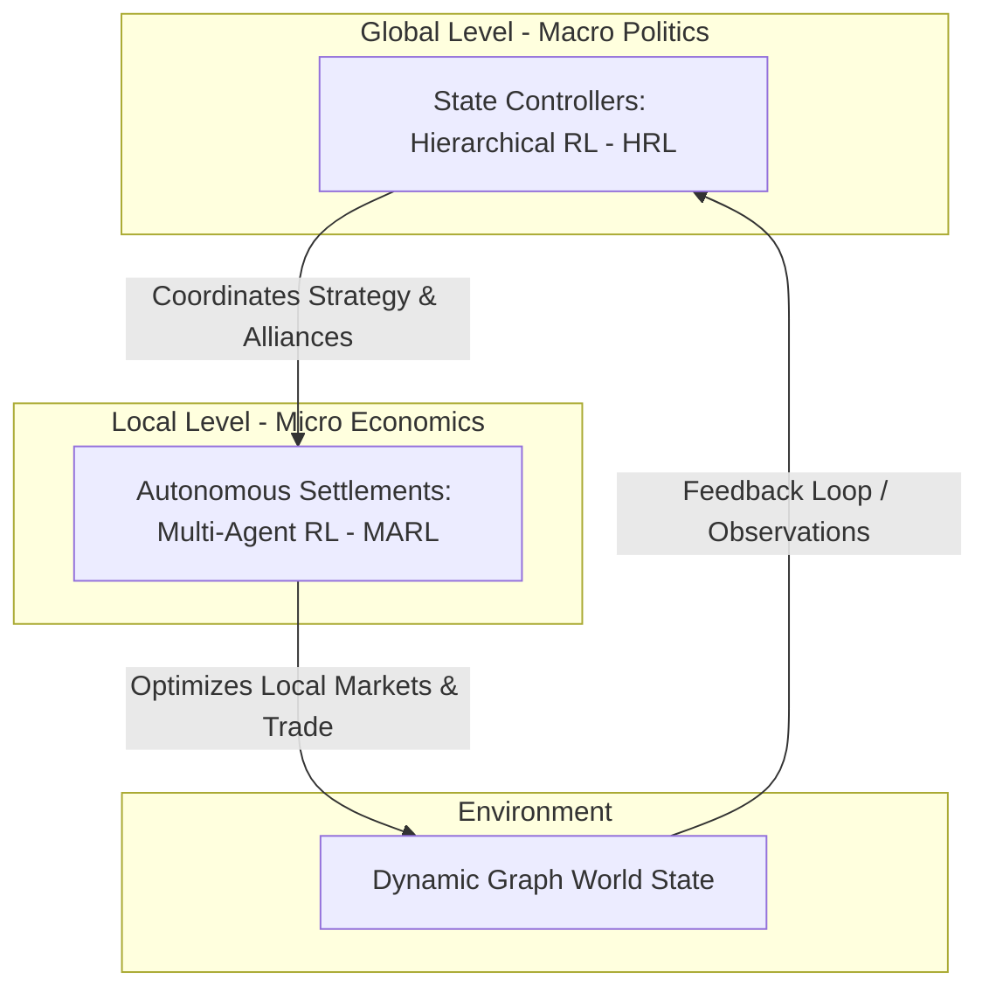

# MARL Grand Strategy Simulation

> **A multi-agent system for simulating geopolitical and economic processes in a game environment.**  
> B.Sc. Team Engineering Thesis | Academic Year 2026/2027  
> **Institution:** Warsaw University of Technology  
> **Faculty:** Faculty of Mathematics and Information Science (MiNI)  
> **Field of Study:** Computer Science and Information Systems (Informatyka i Systemy Informacyjne)

---

## Project Overview

This project focuses on the design, implementation, and evaluation of a complex, multi-agent simulation environment modeling geopolitical and economic processes within a grand strategy game framework.

The target simulated world is structured as a **dynamic graph**, where:
*   **Nodes** represent territorial units (autonomous settlements).
*   **Edges** model time-varying supply chains, trade routes, and diplomatic relations.

The goal is to develop highly scalable simulation architecture capable of handling structural graph changes while processing simultaneous AI actions at different layers of abstraction.

---

## AI Architecture & Decision System

This section describes the target architecture. MARL/HRL training and the dynamic graph of settlement relationships are not implemented yet.

The core Innovation of the project is a hybrid, **two-level hierarchical decision system** that bridges microeconomics and macro-level geopolitics using Reinforcement Learning:


---

## Current implementation

The Rust application generates and displays a map, with camera controls and A*/Dijkstra
overlays. The domain library implements settlement inventories, population needs,
production, construction/upgrade projects, configurable travel-cost productivity,
and prototype trade logs and caravans. Settlement turns, trade and transport are
not wired into a global simulation loop. Nations and AI training remain future work.

Run from the repository root so the application can load `configuration.toml`:

```sh
cargo run -p marl_grand_strategy
```

## Documentation

- [Documentation index](docs/README.md)
- [Project structure and organization rules](docs/architecture/project_structure.md)
- [Source files, types and method descriptions](docs/architecture/code_map.md)
- [Economy](docs/architecture/economy.md)
- [Settlements and turn processing](docs/architecture/settlements.md)
- [Building productivity](docs/architecture/building_productivity.md)
- [Trading and caravans: implementation and limitations](docs/architecture/trading.md)
- [Recorded decisions](docs/decisions/0001-economy.md)
- [Future economy design](docs/planning/economy_roadmap.md)
- [Target simulation aggregates](docs/planning/aggregates.md)

## Workspace

| Directory | Responsibility |
| --- | --- |
| `core/` | Domain model, economic rules, configuration and spatial services |
| `core/tests/` | Public-interface integration tests; unit tests stay inline with implementation |
| `adapters/` | Macroquad camera, map rendering and input |
| `main_app/` | Executable composition and rendering loop |
| `ml_brain/` | Python dependency placeholder; training is not implemented |
| `docs/` | Current architecture, decisions, future plans and historical reviews |

See the [structure guide](docs/architecture/project_structure.md) for the complete
source layout and import changes. Current code and future proposals are documented
separately.
