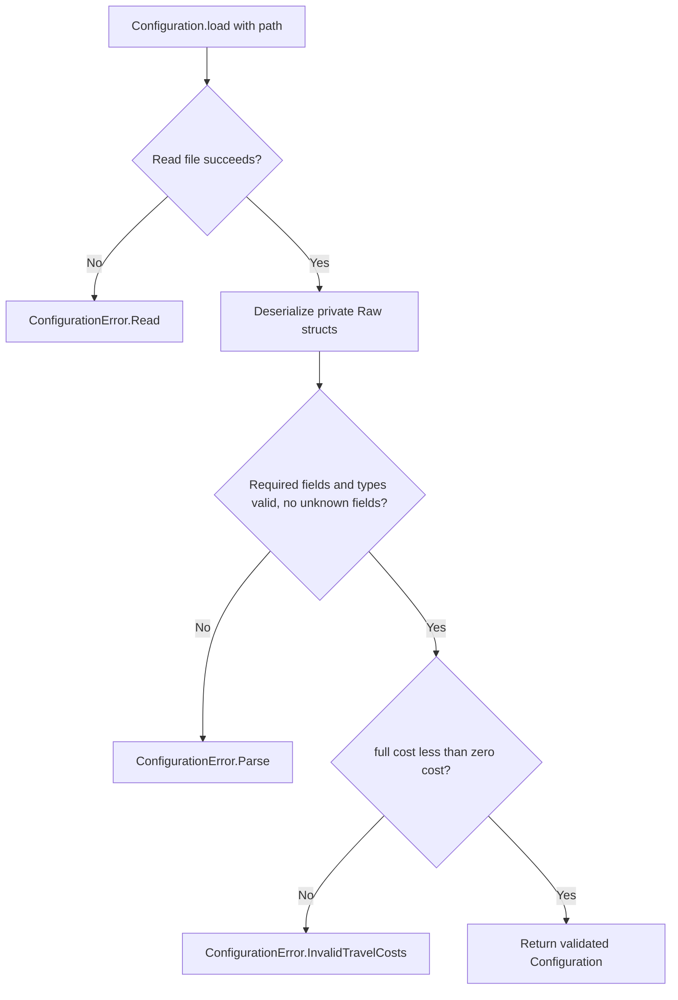

# Configuration Reference

There are two independent configuration paths: runtime productivity TOML and
Rust world-generation parameter structs. Neither is a complete scenario loader.

## Runtime TOML

`Configuration::load(path)` reads a file and calls `from_toml`. The validated model
is `Configuration -> EconomyConfiguration -> TravelCostEfficiencyPolicy`.
Private `RawConfiguration`, `RawEconomy` and `RawBuildingProductivity` structs
deserialize input before conversion to that model.

```toml
[economy.building_productivity]
full_productivity_cost = 100
zero_productivity_cost = 300
```

Both fields are required `u32` values, and full-productivity cost must be strictly
below zero-productivity cost. Unknown fields are rejected. There are no implicit
fallback thresholds or automatic hot reload.

## Loading activity




## World-generation parameters

`world/generation/config.rs` defines dimensions, province count/iterations, seeds,
noise, warp and elevation tuning. `WorldBuilder::generate_default` uses their Rust
defaults; `generate` accepts explicit parameter values. Optional missing seeds can
introduce randomness. These structs are not deserialized by `Configuration::load`.

Need tiers, building definitions, project command costs, starting stock and
population are supplied by scenario code. Definition validation does not imply
that all scenario state is validated centrally: excessive population demand still
panics during checked demand arithmetic. Generated-map shape and province IDs are
validated when constructing `Simulation`; world generation has its own caller
preconditions.

Sources: [runtime parser](../../../core/src/configuration.rs),
[world parameters](../../../core/src/world/generation/config.rs),
[application](../../../main_app/src/main.rs),
[headless example](../../../core/examples/headless.rs).
