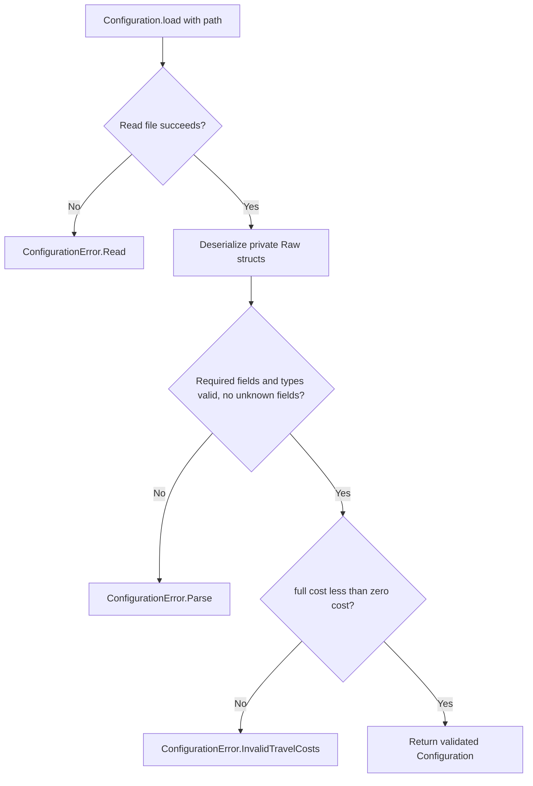

# Configuration Reference

The application loads gameplay TOML at startup, then configures the world
before founding its first settlement. World generation still takes separate
Rust parameter structs.

## Runtime TOML

`Configuration::load(path)` reads a file and calls `from_toml`. The validated model
is `Configuration -> EconomyConfiguration`. It includes the productivity
policy, base trade limits, and national stock capacity.
Private `RawConfiguration`, `RawEconomy` and `RawBuildingProductivity` structs
deserialize input before conversion to that model.

```toml
[economy.building_productivity]
full_productivity_cost = 100
zero_productivity_cost = 300
```

Both fields are required `u32` values, and full-productivity cost must be strictly
below zero-productivity cost. Unknown fields are rejected. There are no implicit
fallback thresholds or automatic hot reload.

`Configuration::configure_world` installs the policy as the default for new
settlements. Registration supplies the settlement capital as the A* origin.
An explicit settlement policy takes precedence over the world default.

## Loading activity




## World-generation parameters

`world/generation/config.rs` defines dimensions, province count/iterations, seeds,
noise, warp and elevation tuning. `WorldBuilder::generate_default` uses their Rust
defaults; `generate` accepts explicit parameter values. Optional missing seeds can
introduce randomness. These structs are not deserialized by `Configuration::load`.

The application reads [building blueprints](building_catalog.md), [founding
supplies and needs](settlement_needs.md), [happiness](settlement_happiness.md),
and the unit and decree catalogs from their TOML files. Simulation validates
the map shape and province IDs before running a turn. The configured settlement
integration tests load the same files and run several turns on a fixed map
with seeded deposits.

Sources: [runtime parser](../../../core/src/configuration.rs),
[world parameters](../../../core/src/domain/world/generation/config.rs),
[application](../../../main_app/src/main.rs),
[headless example](../../../core/examples/headless.rs).
