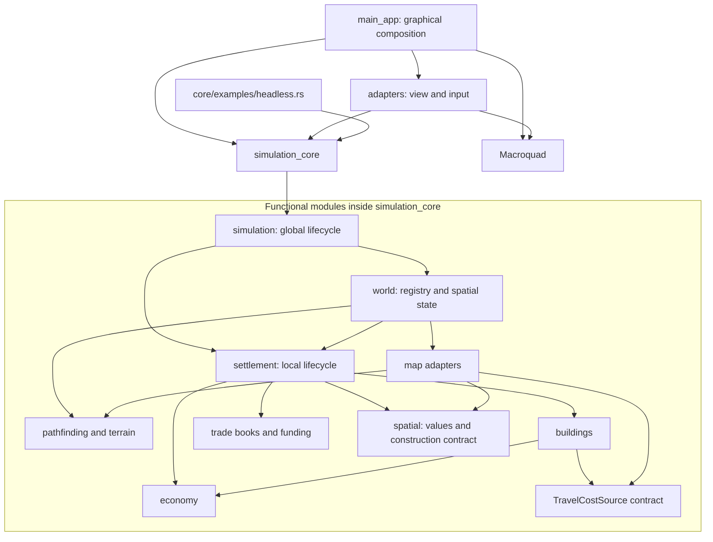

# Components and Dependencies

## Dependency view

An arrow means a code dependency or composition call, not a running network service.

The module view highlights runtime cooperation; it is not a complete import graph.

## Responsibilities

| Component | Owns or coordinates | Does not provide |
| --- | --- | --- |
| `Simulation` | Global time, pending decisions, phase order and owned world | Automatic policies or graphical frame timing |
| `World` | Settlement registration, province index and global occupancy | Economic allocation formulas |
| `Settlement` | Local economic state and project effects | Another private copy of the global tile registry |
| `SettlementRegistry` | One persistent instance per typed ID; sorted iteration | Public insertion that could bypass province validation |
| `adapters` | Camera, textures, input and overlays | Simulation ownership or turn advancement |
| `main_app` | Graphical initialization and frame loop | Headless economic orchestration |

No HTTP API, Python bridge, message broker or distributed runtime exists in this
architecture. [Project structure](../implementation/project_structure.md) and the
[source map](../implementation/code_map.md) locate the implementing files.
