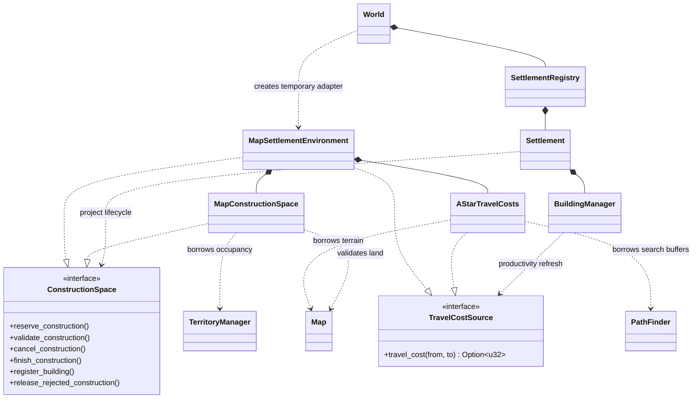
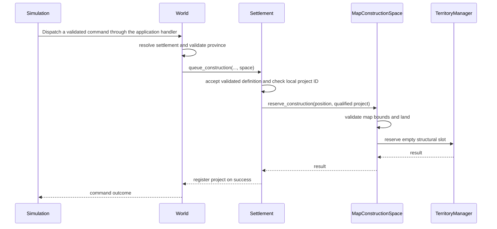

# Settlement Dependency Boundaries

`Settlement` owns local economic state and the project lifecycle. Its runtime
implementation and the buildings module import no `world` types.

Map independence here means independence from the concrete spatial implementation,
not the absence of spatial data. A building retains an immutable `spatial::Position`
and construction retains a target position.

## Contracts and adapters

| Operation | Required capability |
| --- | --- |
| Queue or cancel construction | `ConstructionSpace` |
| Configure productivity | `TravelCostSource` |
| Register a building or execute a local turn | Both |
| Deposit, load/activity settings, storage order, queue upgrade | Neither |

## Command flow

