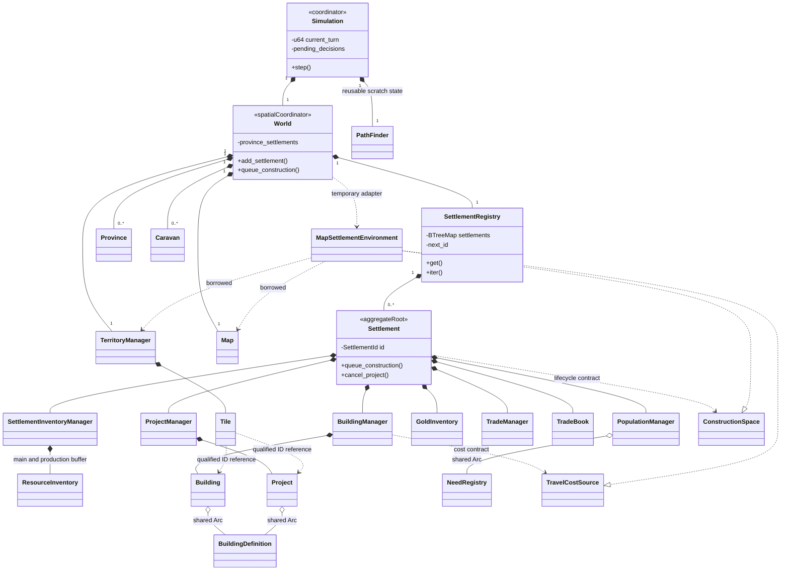

# State Ownership and Aggregate Boundaries

`Simulation` is the global turn coordinator. It owns a `World`; that world owns
one `SettlementRegistry`, the map and the occupancy registry. Each registered
`Settlement` is the command boundary for its own economic state.

## Aggregate and ownership view

This diagram documents implemented ownership and consistency responsibilities.

The planned nation/army aggregates are intentionally absent. They are shown only
in the [target model](../../planning/aggregates.md).

## Consistency boundaries

| Boundary | Invariant and mutation path |
| --- | --- |
| World layers | Map/province collections are private; checked tile edits preserve layer shape and update province tile lists. World also owns the active caravan collection, which remains public. |
| Registration | `World` validates settlement uniqueness, province existence/availability and an empty structural state before updating registry and province index. |
| Local economy | `Settlement` changes private inventories, managers and projects through commands and shared turn phases. |
| Spatial construction | `World` checks province membership; `Settlement` requests reservation/finalization through `ConstructionSpace`; the world adapter validates land and global occupancy. |
| Cancellation | `Settlement` checks the exact project/settlement reservation before removal; an upgrade retains its building. |
| Global turn | `Simulation` preflights all existing project memberships before consuming decisions, moving caravans or advancing any settlement. |
| Trading | Settlement funds and matches books; World resolves visitors, routes departures and queues returns against the same registry. |

These are synchronous in-memory operations using exclusive Rust borrows. There is no global rollback for panics, process failures or already completed turns.

## Identity and access

`SettlementId` is unique within the world's registry. `BuildingId` and `ProjectId`
are local to one settlement. Occupancy uses `(SettlementId, local ID)` references;
province IDs remain independent `usize` values. A definition string ID identifies
a blueprint, not a runtime building.

The registry and settlement views expose shared references. `TileView` borrows
terrain and actual project/building objects; it does not duplicate ownership.

Building position is an immutable value on the instance. The global occupancy
registry stores the reverse position-to-identity lookup; it does not own a second
building. Registration and completion coordinate both views. See
[position responsibility](../systems/buildings.md#position-and-spatial-independence).

`SettlementRegistry` resides in `world/settlement_registry.rs` and is owned by
`World`. Individual settlements do not depend on the registry; see its
[module responsibility](../systems/settlement_registry.md).

Details: [registry](../systems/settlement_registry.md),
[settlements](../systems/settlements.md), [territory](../systems/territory.md).
