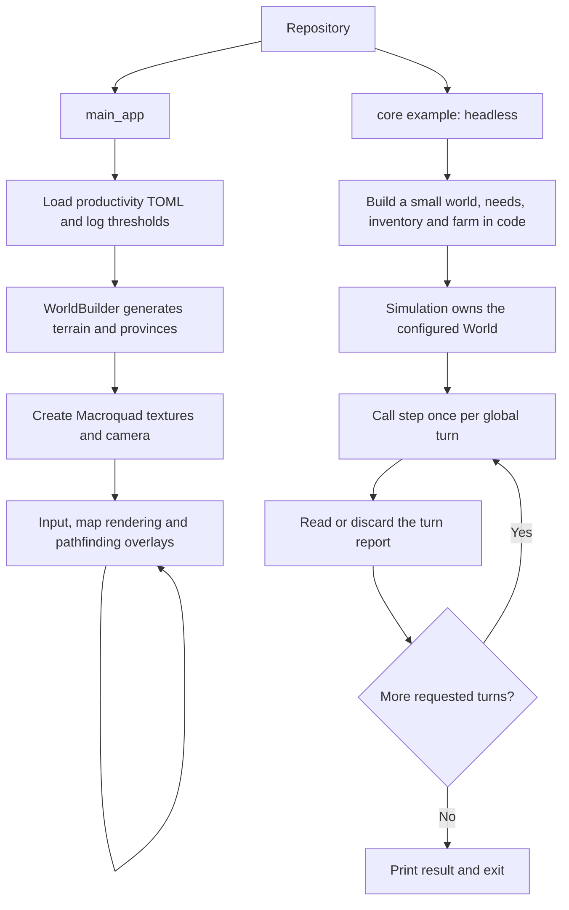

# System Overview

The repository implements a turn-based settlement economy and a generated grid
world in Rust. A `Simulation` can advance multiple settlements without graphics.
The graphical application currently displays the map and pathfinding overlays;
it does not drive simulation turns.

## Execution paths

## Current scope

| Area | Implemented behavior | Boundary |
| --- | --- | --- |
| Global simulation | Ordered phases, queued decisions and turn reports | No AI decision generation, reset/checkpoint API or real-time scheduler |
| Settlements | Needs, inventories, production, projects and cancellation | No automatic population growth or survival penalties |
| Spatial state | Province registration, land placement and structural occupancy | No resource deposits, mobile units or fog of war |
| Buildings | Shared definitions, work allocation, production and upgrades | Stat modifiers are stored but not executed |
| Trade | Offer funding/returns and bilateral matching primitives | No settlement market commands or global matching phase |
| Transport | A* route and caravan state prototype | No automatic arrival trading/unloading or integration in `step` |
| Display | Map, camera, A* and reachable-area overlays | No tile information panel or economic controls |

## Reading next

Read [components](components.md), [ownership](state_ownership.md) and
[global turn execution](turn_lifecycle.md), then follow the
[system index](../README.md#2-systems-understand-one-area).

Sources: [main_app](../../../main_app/src/main.rs),
[headless example](../../../core/examples/headless.rs),
[Simulation](../../../core/src/simulation/mod.rs).
