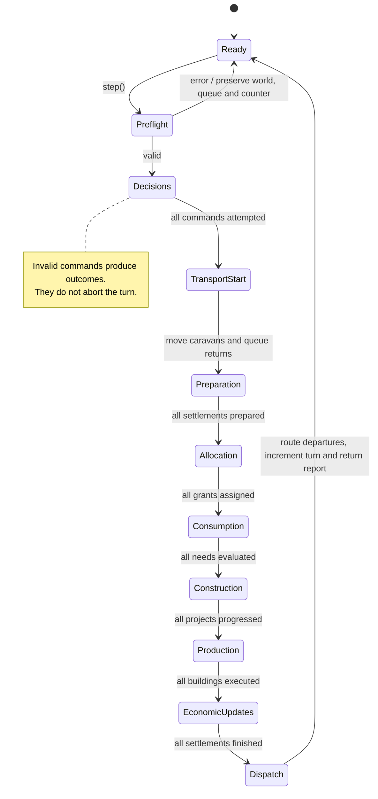
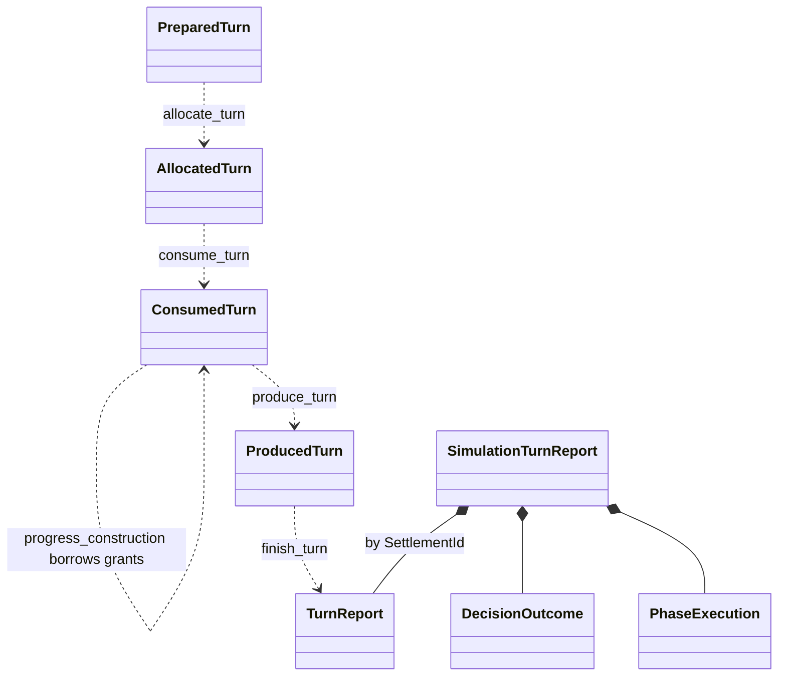

# Global Turn Lifecycle

One successful `Simulation::step()` advances the global counter once. Every phase
runs for all registered settlements in ascending `SettlementId` order before the
next phase begins. The order comes from the registry, not hash-map iteration.

## Phase order

| Phase | Effect |
| --- | --- |
| Decisions | Apply queued commands in submission order within each settlement; report individual rejection. |
| Preparation | Refresh productivity, snapshot opening stock, reject invalid projects, refresh labour, reserve market stock, fund caravan orders and match arrived visitors. |
| Allocation | Gather demands and withdraw material budgets before publishing grants. |
| Consumption | Evaluate population allocations and shortages. |
| Construction | Pay project grants and decrement remaining time once. |
| Production | Execute existing buildings using their allocated inputs and labour. |
| EconomicUpdates | Collect output and trade/internal returns, admit materials, record losses and closing stock, and finalize projects. |

After Decisions, `World::begin_trade_turn` moves existing caravans and queues returns.
After EconomicUpdates, `World::finish_trade_turn` routes funded departures. These
transport boundaries are not separate `TurnPhase` entries. New caravans first
move next turn. See [trading](../systems/trading.md).

## Global sequence


```mermaid
sequenceDiagram
    actor Caller
    participant Sim as Simulation
    participant C as Turn coordinator
    participant H as Command handler
    participant W as World
    participant S as Settlement
    Caller->>Sim: queue_decision(decision)
    Sim-->>Caller: queued or MissingSettlement
    Caller->>Sim: step()
    Sim->>C: run_turn
    C->>C: check counter overflow
    loop Every registered SettlementId
        C->>W: validate_settlement_turn(id)
    end
    alt Preflight fails
        C-->>Sim: SimulationError
        Sim-->>Caller: SimulationError
    else Preflight succeeds
        loop Queued decisions in execution order
            C->>H: handle_decision
            H->>W: check state and apply accepted actions
            H-->>C: decision outcome
        end
        C->>W: begin_trade_turn()
        loop Each remaining global phase, in table order
            loop Every SettlementId in ascending order
                C->>W: borrow target and temporary environment when needed
                C->>S: execute phase
                S-->>C: outcome or transient phase state
            end
        end
        C->>W: finish_trade_turn()
        C-->>Sim: SimulationTurnReport
        Sim->>Sim: store turn number and latest reports
        Sim-->>Caller: SimulationTurnReport
```

Allocation occurs before consumption, construction and production. New products
cannot satisfy this turn's earlier requests. Construction/upgrade finalization
occurs after production, so new definitions affect later turns.

## Execution state view

These are conceptual execution stages of `step`.



## Transient state and reports

The private phase values are moved between calls:



Tests use private helpers to execute settlement phases in isolation.
`Simulation::step()` is the public entry point for advancing a turn.


API details: [simulation commands](../implementation/simulation_commands.md).
Code: [global pipeline](../../../core/src/application/simulation/turn_coordinator.rs),
[shared local phases](../../../core/src/domain/settlement/model/turn/mod.rs).
