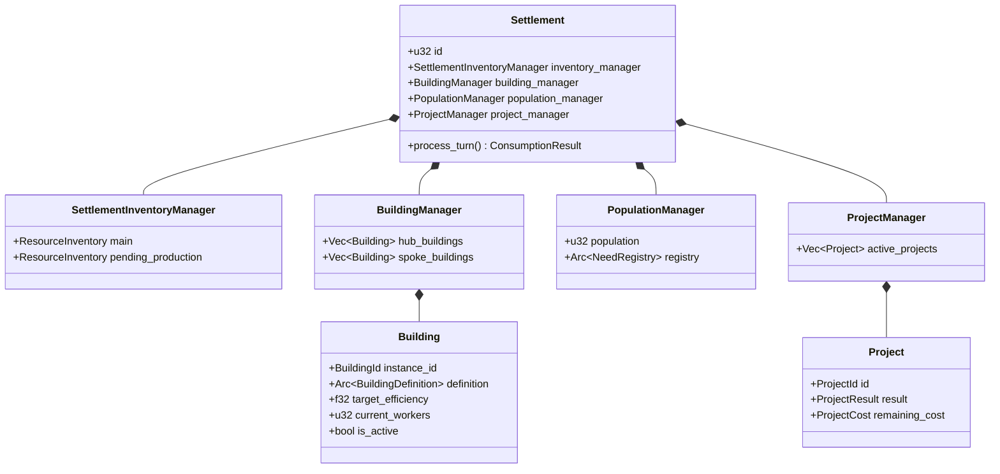
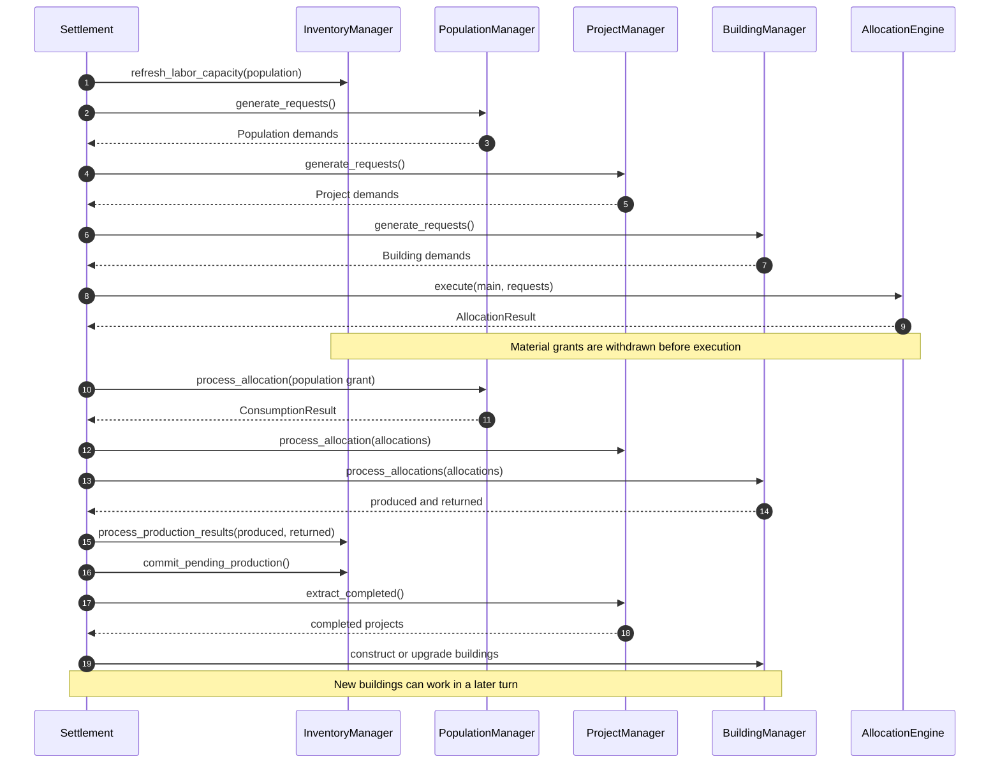

# Settlements: Model and Turn Lifecycle

This document describes the implementation including `fix/economy` (`9d24d16`). Accounting rules are documented in [economic.md](economic.md); future features are in [economy_roadmap.md](economy_roadmap.md). The diagrams below represent current types and execution flow.

## 1. Scope

`Settlement` coordinates the local population, inventory, buildings and projects. It is intended as a future decision point for a MARL agent, but currently contains no AI model, policy, observations or reward.

## 2. Model Components

| `Settlement` field | Type | Responsibility |
| --- | --- | --- |
| `id` | `u32` | Settlement identity |
| `inventory_manager` | `SettlementInventoryManager` | Warehouse and production buffer |
| `building_manager` | `BuildingManager` | Hub/Spoke collections, requests, production and upgrades |
| `population_manager` | `PopulationManager` | Population count, needs registry and grant evaluation |
| `project_manager` | `ProjectManager` | Active projects, remaining costs and completion |

`Settlement::new(id, initial_capacity, initial_population, need_registry)` creates an empty warehouse and buffer with the requested capacity, no buildings or projects, and a population manager with a shared `Arc<NeedRegistry>`.

Manager modules and `demographics` remain private in `settlement/mod.rs`, although settlement fields are public. In particular, an external crate cannot normally name `NeedTier` and `NeedRegistry` to create its own needs configuration. Type inference permits a default empty registry through `Arc::default()`. Completing these exports remains future API work.

## 3. Turn Sequence

`process_turn(&mut self) -> ConsumptionResult` accepts neither actions nor a time parameter. It performs these steps:

1. **Refresh labour:** set `main[Labour] = population`.
2. **Gather requests:** population needs, remaining project costs, building inputs and labour.
3. **Allocate:** distribute resources proportionally with remainder allocation; withdraw materials from `main`.
4. **Evaluate and execute:** population evaluates its grant, projects reduce costs, buildings produce and return unused materials.
5. **Account for inventory:** return unused materials to `main`, put products in `pending_production`, then drain the buffer into `main`.
6. **Finalize projects:** remove completed projects and construct buildings or replace building definitions.
7. **Return the result:** return population satisfaction without changing the population count automatically.

Request gathering order does not establish population priority over industry or projects. The allocator considers all demands together. Population takes precedence only when remainders are equal under recipient ordering.

Products created during a turn cannot satisfy its earlier demands. Construction finishes after production, so a new building cannot work in its completion turn. It also starts with `target_efficiency = 0.0`, which must be set. An upgraded building retains its instance state; the new definition participates in the next demand phase.

## 4. Building Definitions and Instances

`BuildingDefinition` contains `id: String`, `name`, `tier`, `max_workers`, `behaviors` and `construction_cost`. `BuildingFactory::register` stores a definition under its string ID; registration under an existing ID replaces the entry. `get_blueprint(id)` returns `Option<Arc<BuildingDefinition>>`. Existing buildings retain their previous `Arc`; registering a replacement does not upgrade them automatically.

`Building` holds a `BuildingId`, `Position { x: i32, y: i32 }`, `BuildingLocation`, a shared definition, activity, target efficiency and current worker count. The string definition ID identifies a building type; `instance_id` identifies a particular building.

`BuildingLocation::Hub` and `Spoke` select one of two collections. The code does not validate territorial boundaries, occupied positions, distance from the center or local resource availability. These categories do not yet apply bonuses or logistical costs.

| Behavior | Implementation status |
| --- | --- |
| `Production { inputs, outputs }` | Executed under the economy rules |
| `StatModifier { stat, base_amount, per_worker_amount }` | Stored in definitions, but not executed |

`StatType` contains `HousingCapacity`, `InventoryCapacity` and `TradeCapacity`. Stat aggregation and automatic warehouse capacity changes from buildings do not exist yet.

Replacing an `Arc` in `Building::upgrade` is O(1). `BuildingManager::upgrade_building` first searches both collections linearly, making the complete lookup and upgrade O(B). It returns `false` when the target does not exist.

## 5. Construction and Upgrade Projects

`Project` stores a `ProjectId`, `ProjectResult` and `remaining_cost: ProjectCost`. Cost consists of `needed_resources: HashMap<ResourceType, u32>` and `turn_cost: u32`.

| Project result | Action on completion |
| --- | --- |
| `ConstructBuilding` | Creates a building at the supplied location and position with the supplied definition |
| `UpgradeBuilding` | Replaces the definition of the target `BuildingId` |
| `RecruitUnit` | The variant exists, but finalization remains `todo` |

`queue_construction` and `queue_upgrade` accept a caller-supplied project ID and explicit `ProjectCost`. They do not automatically use `BuildingDefinition.construction_cost`. The definition cost is available as data; consistency with the command cost remains the caller's responsibility.

Each turn, a project requests its entire remaining material cost. `resolve_allocation` subtracts grants with `saturating_sub` and removes entries reduced to zero. The time counter decreases by 1 if positive, even without material delivery. It represents elapsed turns since ordering, rather than work turns after payment. Completion requires an empty cost map and zero time remaining.

Example: a project costs 10 wood and 2 turns. Turn one delivers 4 wood, leaving 6 wood and 1 turn. Turn two delivers nothing, leaving 6 wood and 0 turns. Turn three delivers 6 wood; the project completes during finalization of that turn.

`ProjectManager` advances all active projects concurrently. There is no single construction slot or queue that processes only the first item. `extract_completed()` removes completed projects while preserving the order of remaining ones.

## 6. ID Uniqueness and Command Results

| Operation | Result |
| --- | --- |
| `construct_building(building)` | `Result<(), BuildingId>`: an error identifies an existing building with that ID, including one in the other location collection |
| `add_project(project)` | `Result<(), ProjectId>`: an error identifies an existing active project with that ID |
| `queue_construction(...)`, `queue_upgrade(...)` | Return the project registration result |
| `next_available_id()` | The first free `BuildingId`, starting at 0 and checked against Hub and Spoke |

A completed construction receives a building ID independently of its project number. A project ID is not a global identity for the resulting object. Typed arguments prevent passing a `ProjectId` as an upgrade target.

Validation applies to manager methods. Collections and fields remain public, so direct mutation can bypass uniqueness checks. There is no completed-project history; a project number can be reused after it leaves the active list.

## 7. Limitations and Open Questions

- A zero cost entry such as `{Wood: 0}` can block completion because the code checks map emptiness, while a zero grant does not remove the entry.
- Upgrade targets are not validated when queued. Finalization ignores `false`: a paid project can disappear without an effect or refund.
- `RecruitUnit` can settle its cost without creating a unit.
- There is no project cancellation, cost refund, position validation, population change or global turn integration.
- Warehouse overflow has no deterministic policy. Population satisfaction now uses shared integer demand in the same units as building inputs and project costs, and caps each good's contribution; details are in [economic.md](economic.md).

These limitations describe current code rather than approving final game rules. Policies requiring further decisions are collected in [0001-economy.md](../decisions/0001-economy.md).

## 8. Sources

Model and coordinator: [settlement/core.rs](../../core/src/domain/settlement/core.rs). Managers: [building_manager.rs](../../core/src/domain/settlement/building_manager.rs), [project_manager.rs](../../core/src/domain/settlement/project_manager.rs). Projects: [projects.rs](../../core/src/domain/settlement/projects.rs). Turn tests: [turn_tests.rs](../../core/src/domain/settlement/turn_tests.rs).
