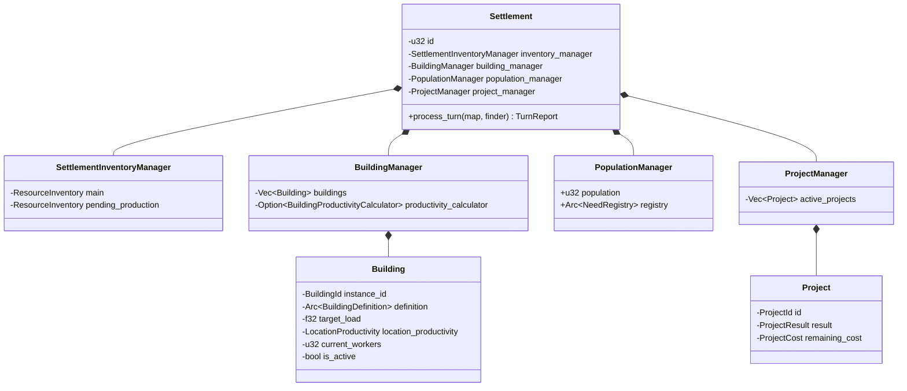
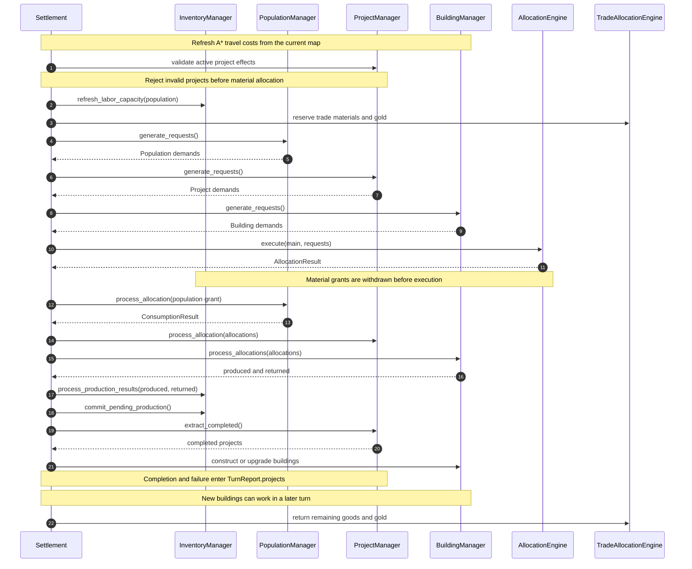

# Settlements: Model and Turn Lifecycle

This document describes the implemented settlement model. Accounting rules are documented in [economy.md](economy.md); prototype trade behavior is described in [trading.md](trading.md), and future features are in [economy_roadmap.md](../planning/economy_roadmap.md). See the [code map](code_map.md) for file responsibilities and method descriptions.

## 1. Scope

`Settlement` coordinates the local population, inventory, buildings and projects. It is intended as a future decision point for a MARL agent, but currently contains no AI model, policy, observations or reward.


## 2. Model Components

| `Settlement` field | Type | Responsibility |
| --- | --- | --- |
| `id` | `u32` | Settlement identity |
| `inventory_manager` | `SettlementInventoryManager` | Warehouse and production buffer |
| `building_manager` | `BuildingManager` | Building collection, productivity calculator, requests, production and upgrades |
| `population_manager` | `PopulationManager` | Population count, needs registry and grant evaluation |
| `project_manager` | `ProjectManager` | Active projects, remaining costs and completion |



`Settlement::new(id, initial_capacity, initial_population, need_registry)` creates an empty warehouse and buffer with the requested capacity, no buildings or projects, no distance penalty (`BuildingManager.productivity_calculator = None`), and a population manager with a shared `Arc<NeedRegistry>`.

Each settlement owns an independent ordered storage list. `set_storage_order(materials: impl AsRef<[ResourceType]>)` validates it against the material catalogue; `storage_order()` returns a read-only slice. No numerical priority weights are stored. See [economy.md](economy.md).

Settlement fields and manager modules are private implementation details. Public reads use `id()`, `population()`, `inventory()`, `pending_inventory()`, `buildings()` and `active_projects()`. Building and project views expose immutable identity, definitions and remaining costs through accessors. There is no mutable collection getter.

The model, constructor and read-only views live in `settlement/mod.rs`. Mutation commands live in the private `commands/` directory, grouped by inventory, buildings and projects. `turn.rs` contains turn orchestration and `project_lifecycle.rs` contains validation/finalization. These files implement methods directly on the same `Settlement` type. Import it as `core::domain::settlement::Settlement`.

The aggregate also owns a `GoldInventory` and `TradeLog`, both initially empty. The diagram focuses on local economy managers; trade reservations/returns occur around the allocation cycle described below.

Use `deposit()`, `withdraw()` and `set_inventory_capacity()` to change warehouse stock or capacity. Add validated buildings through `add_building()`; duplicate IDs are rejected. Change a managed building through `set_building_load()` or `set_building_active()`, which reject missing IDs. Queue projects through `queue_construction()` and `queue_upgrade()`, which validate definitions before any allocation. `NeedRegistry` and `NeedTier` are re-exported for external needs configuration.

## 3. Turn Sequence

`process_turn(&mut self, map: &Map, finder: &mut PathFinder) -> TurnReport` receives the current map and a reusable pathfinding buffer. It refreshes A* travel costs before gathering economic requests and accepts neither actions nor a time parameter. It performs these steps:

0. **Refresh building productivity:** compute current A* travel costs from the capital using the configured policy. Then **validate projects:** remove unsupported projects and upgrades without a target, recording their errors before allocation.
1. **Refresh labour:** set `main[Labour] = population`.
   Then reserve materials and gold requested by `TradeLog` through `TradeAllocationEngine`, before local demand allocation.
2. **Gather requests:** population needs, remaining project costs, building inputs and labour.
3. **Allocate:** distribute resources proportionally with remainder allocation; withdraw materials from `main`.
4. **Evaluate and execute:** population evaluates its grant, projects reduce costs, buildings produce and return unused materials.
5. **Account for inventory:** return unused materials to `main`, put products in `pending_production`, then drain the buffer into `main`.
6. **Finalize projects:** remove completed projects, check their effects again and report construction, upgrade or failure.
7. **Return trade resources:** drain purchased/unsold goods and remaining gold from the trade log into settlement inventories. The closing inventory snapshot currently precedes this step; trade transfers/losses are not included in local inventory accounting.
8. **Return the report:** return population satisfaction, project outcomes and local inventory accounting without changing the population count automatically.



Request gathering order does not establish population priority over industry or projects. The allocator considers all demands together. Population takes precedence only when remainders are equal under recipient ordering.

Products created during a turn cannot satisfy its earlier demands. Construction finishes after production, so a new building cannot work in its completion turn. It also starts with `target_load = 0.0`, which must be set. An upgraded building retains its instance state; the new definition participates in the next demand phase.

## 4. Building Definitions and Instances

`BuildingDefinition` contains `id: String`, `name`, `tier`, `max_workers`, `behaviors` and `construction_cost`. `BuildingFactory::register` stores a definition under its string ID; registration under an existing ID replaces the entry. `get_blueprint(id)` returns `Option<Arc<BuildingDefinition>>`. Existing buildings retain their previous `Arc`; registering a replacement does not upgrade them automatically.

`Building` holds a `BuildingId`, `Position { x: i32, y: i32 }`, a shared definition, activity, target load, location productivity and current worker count. The string definition ID identifies a building type; `instance_id` identifies a particular building.

All buildings belong to one collection; Hub/Spoke and `BuildingLocation` have been removed. An optional `BuildingProductivityCalculator` owned by `BuildingManager` configures the capital position and a validated `TravelCostEfficiencyPolicy`. `Settlement` delegates configuration and refresh operations to the manager. Its linear output penalty uses A* route costs and preserves staffing and material costs. Thresholds are loaded from the repository-root `configuration.toml`. `set_building_productivity_calculator()` and `add_building()` also receive the map and mutable pathfinding buffer so their cached productivity values are immediately correct. The code does not validate territorial boundaries, occupied positions or local resource availability. See [building_productivity.md](building_productivity.md) for configuration, exact arithmetic and migration details.

| Behavior | Implementation status |
| --- | --- |
| `Production { inputs, outputs }` | Executed under the economy rules |
| `StatModifier { stat, base_amount, per_worker_amount }` | Stored in definitions, but not executed |

`StatType` contains `HousingCapacity`, `InventoryCapacity` and `TradeCapacity`. Stat aggregation and automatic warehouse capacity changes from buildings do not exist yet.

Replacing an `Arc` in `Building::upgrade` is O(1). `BuildingManager::upgrade_building` first searches the collection linearly, making the complete lookup and upgrade O(B). It returns `false` when the target does not exist.

## 5. Construction and Upgrade Projects

`Project` stores a `ProjectId`, `ProjectResult` and `remaining_cost: ProjectCost`. Cost consists of `needed_resources: HashMap<ResourceType, u32>` and `turn_cost: u32`.

| Project result | Action on completion |
| --- | --- |
| `ConstructBuilding` | Creates a building at the supplied position with the supplied definition |
| `UpgradeBuilding` | Replaces the definition of the target `BuildingId` |
| `RecruitUnit` | Explicitly rejected with `UnsupportedRecruitment` |

Recruitment is currently unsupported: an active `RecruitUnit` project is rejected with `UnsupportedRecruitment` before it can receive materials. No unit is created.

`queue_construction` and `queue_upgrade` accept a caller-supplied project ID and explicit `ProjectCost`. They do not automatically use `BuildingDefinition.construction_cost`. The definition cost is available as data; consistency with the command cost remains the caller's responsibility.

Zero material entries are removed when a project is created or registered and after allocation. Demand excludes zero entries defensively. `is_fully_paid()` checks that all remaining amounts are zero and time is zero, so a stray zero entry cannot block completion.

Each turn, a valid project requests its entire remaining material cost. `resolve_allocation` subtracts grants with `saturating_sub` and removes entries reduced to zero. The time counter decreases by 1 if positive, even without material delivery. It represents elapsed turns since ordering, rather than work turns after payment. This timing rule is unchanged.

Example: a project costs 10 wood and 2 turns. Turn one delivers 4 wood, leaving 6 wood and 1 turn. Turn two delivers nothing, leaving 6 wood and 0 turns. Turn three delivers 6 wood; the project completes during finalization of that turn.

`ProjectManager` advances all active projects concurrently. There is no single construction slot or queue that processes only the first item. `extract_completed()` removes completed projects while preserving the order of remaining ones.

## 6. ID Uniqueness and Command Results

| Operation | Result |
| --- | --- |
| `construct_building(building)` | `Result<(), BuildingId>`: an error identifies an existing building with that ID |
| `add_project(project)` | `Result<(), ProjectId>`: an error identifies an existing active project with that ID |
| `queue_construction(...)`, `queue_upgrade(...)` | `Result<(), ProjectError>`: report duplicate projects, missing upgrade targets or invalid definitions before accepting a command |
| `next_available_id()` | The first free `BuildingId`, starting at 0 and checked against all buildings |

A completed construction receives a building ID independently of its project number. A project ID is not a global identity for the resulting object. Typed arguments prevent passing a `ProjectId` as an upgrade target.

Validation applies to commands. Collections and runtime fields are protected from external mutation. There is no completed-project history; a project number can be reused after it leaves the active list.

## 7. Turn Report and Project Outcomes

The public report is defined in [turn_report.rs](../../core/src/domain/settlement/turn_report.rs):

```rust
pub struct TurnReport {
    pub consumption: ConsumptionResult,
    pub projects: Vec<ProjectOutcome>,
    pub inventory: InventoryTurnReport,
}

pub struct ProjectOutcome {
    pub project_id: ProjectId,
    pub result: Result<ProjectCompletion, ProjectError>,
}
```

Successful outcomes identify `BuildingConstructed(BuildingId)` or `BuildingUpgraded(BuildingId)`. Errors include `MissingBuilding`, `UnsupportedRecruitment` and duplicate IDs. Construction allocates its own building ID; upgrades preserve the target ID and position. Population evaluation is now accessed through `report.consumption`.

Queue errors are returned immediately and do not enter the active list. At turn start, invalid active projects are removed and reported before material withdrawal. Finalization also checks the target and handles the effect result explicitly. Pending projects produce no outcome entry. An outcome is emitted only in the turn that removes its project; no history is stored in the settlement. Pre-allocation rejections appear first, followed by finalization outcomes, preserving project order within each phase.

If an upgrade target disappears after earlier partial payment, the next turn reports failure without further allocation. Previously paid materials remain spent; this stage does not introduce refund or cancellation rules.

`inventory` records local material stock, production, internal returns, consumption categories and stage-specific overflow losses. `inventory.is_balanced()` checks this accounting separately for each material, excluding renewed labour. Trade reservations/returns are not accounted for, so this check does not establish conservation for nonempty trade activity. The local balance equation is documented in [economy.md](economy.md); trade limitations are in [trading.md](trading.md).

## 8. Limitations and Open Questions

- Recruitment remains unimplemented and is explicitly rejected.
- There is no project cancellation, cost refund, position validation, population change or global turn integration.
- Overflow uses a configurable ordered material list. There is no automatic policy choosing this order. Resource maps are private; capacity changes use validated commands.

These limitations describe current code rather than approving final game rules. Policies requiring further decisions are collected in [0001-economy.md](../decisions/0001-economy.md).

## 9. Sources

Model and views: [settlement/mod.rs](../../core/src/domain/settlement/mod.rs). Commands: [inventory](../../core/src/domain/settlement/commands/inventory.rs), [buildings](../../core/src/domain/settlement/commands/buildings.rs), [projects](../../core/src/domain/settlement/commands/projects.rs). Turn processing and inline unit tests: [turn.rs](../../core/src/domain/settlement/turn.rs). Project effects: [project_lifecycle.rs](../../core/src/domain/settlement/project_lifecycle.rs). Managers: [building_manager.rs](../../core/src/domain/settlement/building_manager.rs), [project_manager.rs](../../core/src/domain/settlement/project_manager.rs), [inventory_manager.rs](../../core/src/domain/settlement/inventory_manager.rs), [population.rs](../../core/src/domain/settlement/population.rs). Projects: [projects.rs](../../core/src/domain/settlement/projects.rs).
