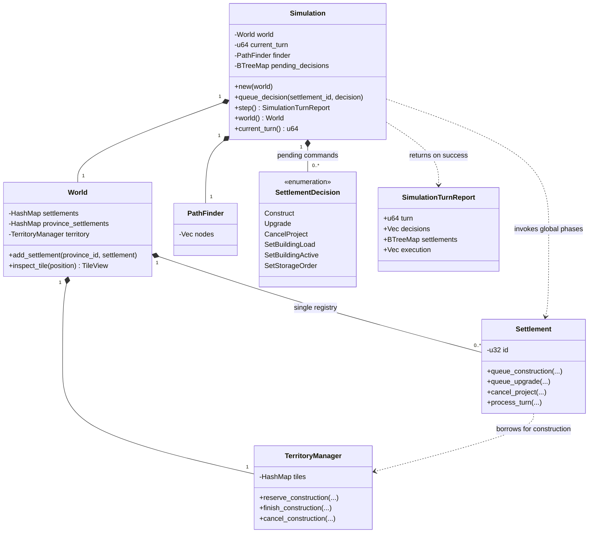
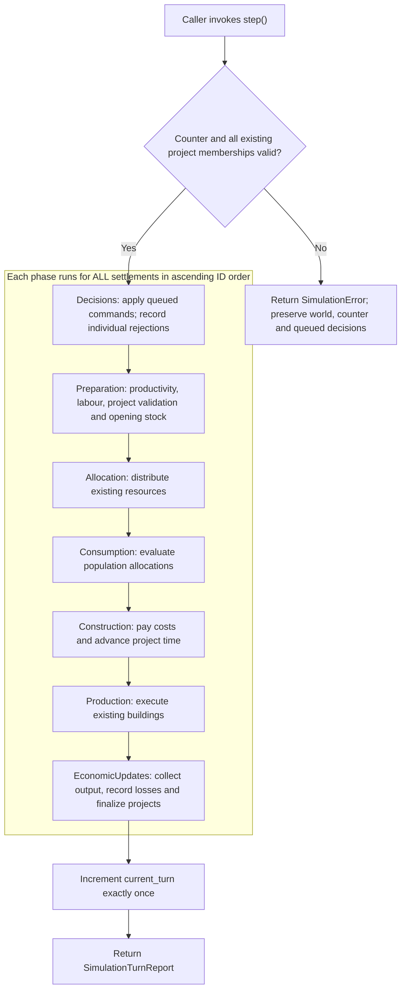

# Global Simulation Coordinator

`simulation_core::simulation::Simulation` owns a `World`, the number of completed
global turns, reusable pathfinding buffers and queued settlement decisions.
Settlements remain registered only in `World`; the coordinator has no duplicate
settlement collection. `Simulation::settlements()` delegates read access to it.

The implementation is independent of Macroquad and does not initialize a window.
The graphical executable still renders a generated world; it does not yet drive
the coordinator from its frame loop.

## Ownership and responsibilities

The diagram focuses on the coordinator and its direct dependencies. Composition
means ownership of Rust values; `SettlementDecision` is an enum, not an AI agent.
World contains other collections (such as provinces and caravans), omitted here.



## Lifecycle

Configure a world, register settlements, seed inventories and add initial buildings
using the existing world/settlement commands. Then transfer it into
`Simulation::new(world)`. Alternatively register empty settlements through
`Simulation::add_settlement` before stepping. World registration still enforces
one province per settlement and at most one settlement per province.

The constructor validates map dimensions, buffer lengths, finite terrain values and
unique/existing province IDs before creating the pathfinding buffer. Turn zero
means no global turns have completed. Each successful `step()` returns a report
for turn `current_turn + 1` and increments the counter exactly once, including
for a world with no settlements.

## Global phases

All registered settlements finish one phase before any settlement enters the next.
Every phase visits settlement IDs in ascending order, independent of registration
order or `HashMap` iteration. Within a settlement, decisions retain submission order.

| Phase | Work |
| --- | --- |
| `Decisions` | Apply queued construction, upgrade, cancellation, building-load/activity and storage-order commands. |
| `Preparation` | Refresh A* productivity, snapshot opening stock, reject invalid projects, refresh labour and reserve prototype trade resources. |
| `Allocation` | Gather population, project and building demand; allocate resources once from existing stock. |
| `Consumption` | Evaluate population consumption and shortages using those allocations. |
| `Construction` | Pay remaining project costs and advance project time exactly once. |
| `Production` | Execute existing buildings using their allocated inputs and labour. |
| `EconomicUpdates` | Collect output/returns, account for overflow, snapshot closing stock, finalize projects and return prototype trade resources. |



The arrows connect whole global phases, not consecutive operations for one
settlement. An invalid individual decision is recorded inside the first phase;
it does not take the preflight failure branch. Finalizing construction after
production prevents a new building or upgraded definition from producing early.

This preserves existing settlement economics. New output is unavailable to demands
already allocated in this turn. New buildings and upgraded definitions are applied
after production and can affect production only in a later turn. New buildings
retain the existing default load of zero until configured.

`Settlement::process_turn` remains a local convenience entry point, invoking the
same phase methods in the same order. During global execution, `Simulation::step`
calls those methods across all settlements rather than executing each complete
local turn sequentially. Intermediate phase state is transient and private to
the crate; it is not a second persistent simulation model.

## Decisions and failures

`queue_decision(settlement_id, SettlementDecision)` only queues a command; it does
not change the world immediately. Unknown settlements are rejected when queueing.
The decision type supports `Construct`, `Upgrade`, `CancelProject`,
`SetBuildingLoad`, `SetBuildingActive` and `SetStorageOrder`.

Before consuming queued decisions, `step` checks counter overflow and validates
all existing settlement projects' province membership. A preflight error preserves
the turn counter, pending decisions and world state, including settlements that
would otherwise run before the invalid one. There is no partially completed
recoverable turn.

An individual invalid decision is a different outcome: it is rejected using the
existing command validation, recorded in `DecisionOutcome`, and subsequent commands
and economic phases still run. Successful commands are not rolled back because
another command was rejected. Decisions are consumed once, not replayed each turn.

The coordinator exposes only shared world access while running. `into_world`
recovers the world for external scenario edits and discards queued decisions;
creating another coordinator starts its counter at zero. This is not a checkpoint
or resume API. There is no world rollback for panics or process failures.

## Reports

`SimulationTurnReport` contains the completed turn number, decision outcomes,
settlement `TurnReport`s in a `BTreeMap` and `PhaseExecution` entries recorded at
actual phase invocations. These entries make global ordering inspectable.
The existing inventory accounting boundary is unchanged: it does not cover
prototype trade reservations/returns. See [economy.md](economy.md).

## Headless execution

Run the included deterministic example without initializing graphics:

```sh
cargo run -p simulation_core --example headless -- 100
```

The example builds a small farm scenario and calls `step()` in a loop, dropping
each report after the turn instead of retaining an unbounded history. The optional
argument is the number of turns; the default is 10.

## Validation and scope

Tests cover turn progression, empty worlds, global phase ordering, insertion-order
independence, economic equivalence with local turns, delayed output availability,
construction/upgrade completion, decisions, cancellation, preflight failures and
counter overflow. Unit tests remain alongside their implementation; public API
tests live in `core/tests/simulation_tests.rs`.

AI policies, automatic decision generation, graphics integration, caravan travel,
trade matching, checkpointing and world generation seed reproducibility are not
introduced by this coordinator. It makes the current settlement economy runnable
through a shared global lifecycle.
