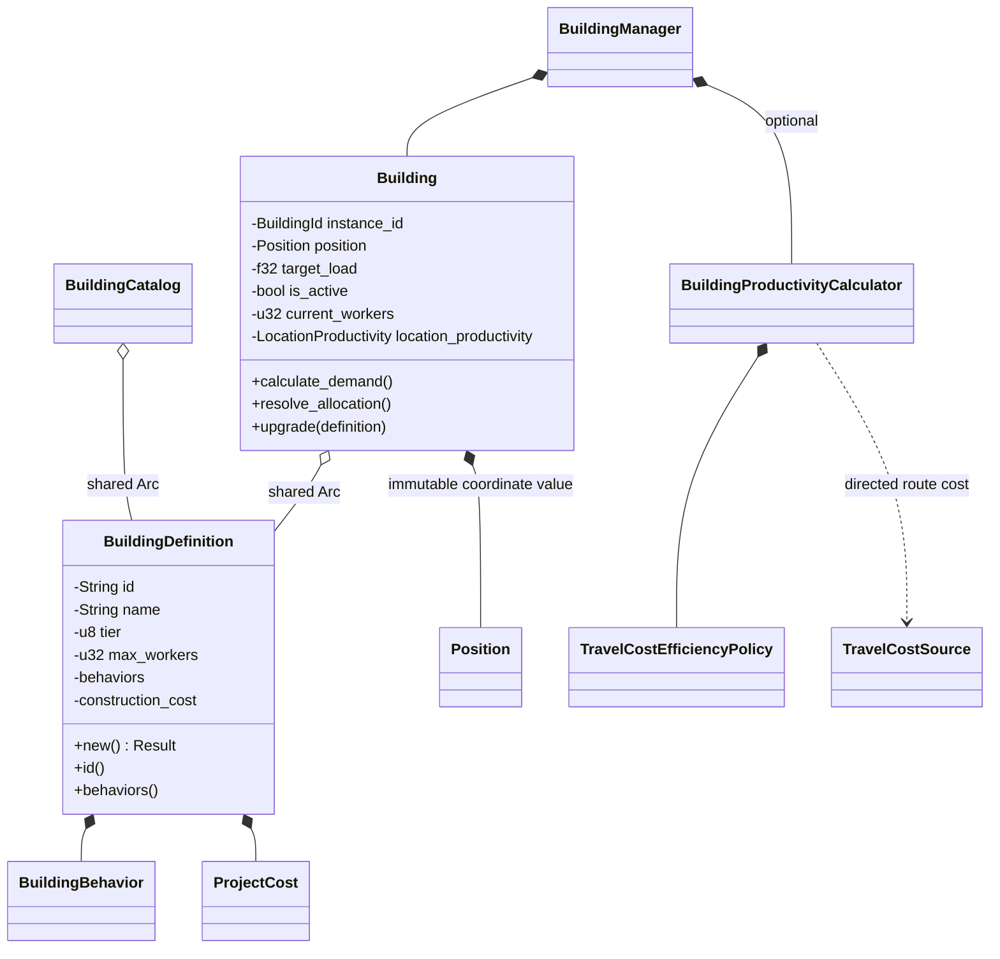
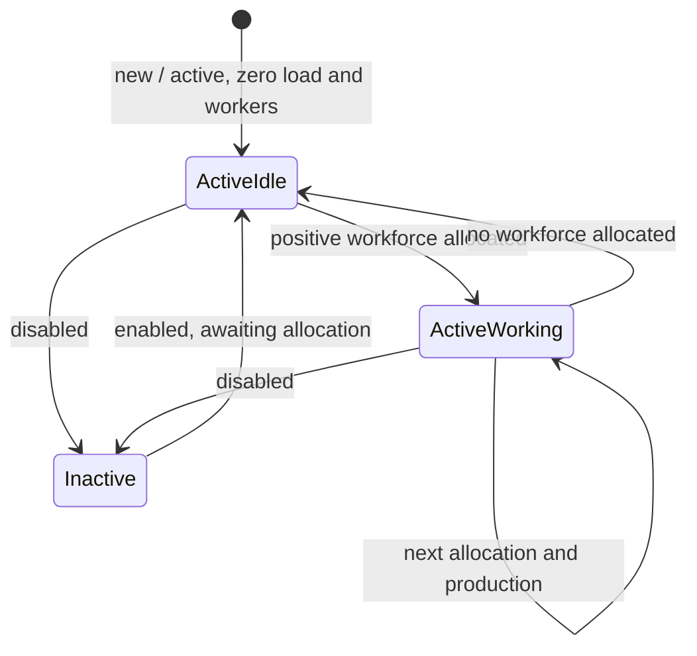

# Buildings

A runtime `Building` belongs to a settlement and occupies one structural tile.
Its `BuildingDefinition` describes a building type and may be shared with other
instances.

## Position and spatial independence

`Building.position` is a private, immutable `spatial::Position` value exposed by
`position()`. It describes the location of this instance; the shared definition
has no position.

The building answers "where is this instance?". The world's `TerritoryManager`
answers "what occupies this position?" .

## Definition and instance classes

The catalogue's string ID identifies a blueprint. `BuildingId` identifies an
instance within one settlement

## Operating state view

There is no stored building-state enum. These states summarize the activity flag
and workforce when allocation is resolved.

## Production and upgrades

`Production` behaviors execute recipes; `StatModifier` behaviors are currently
stored.
Upgrades preserve position, instance ID and the existing structural slot. They finish after production, so new recipes apply in a later turn.

Details: [productivity formulas and configuration](../implementation/building_productivity.md),
[production arithmetic](../implementation/economy_rules.md#5-building-production),
[project lifecycle](settlements.md#project-lifecycle).

`Building::resolve_allocation` returns `ProductionResult` directly, containing
`produced` and `unused` material maps. There is no intermediate
`BuildingUpdateResult` wrapper. The internal production calculation receives a
reference to the prepared grants; missing allocations are handled at the public
allocation boundary.
