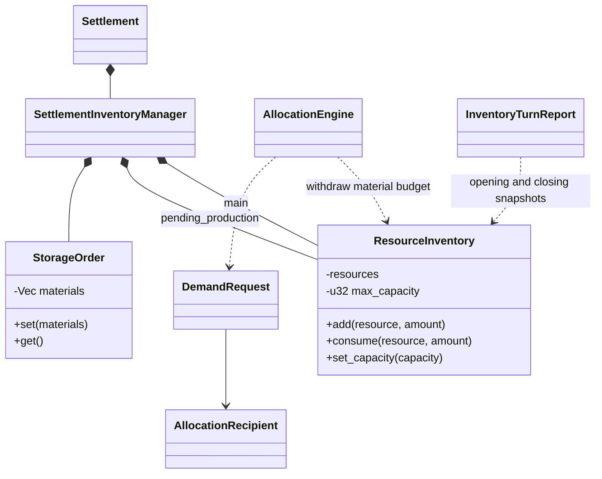
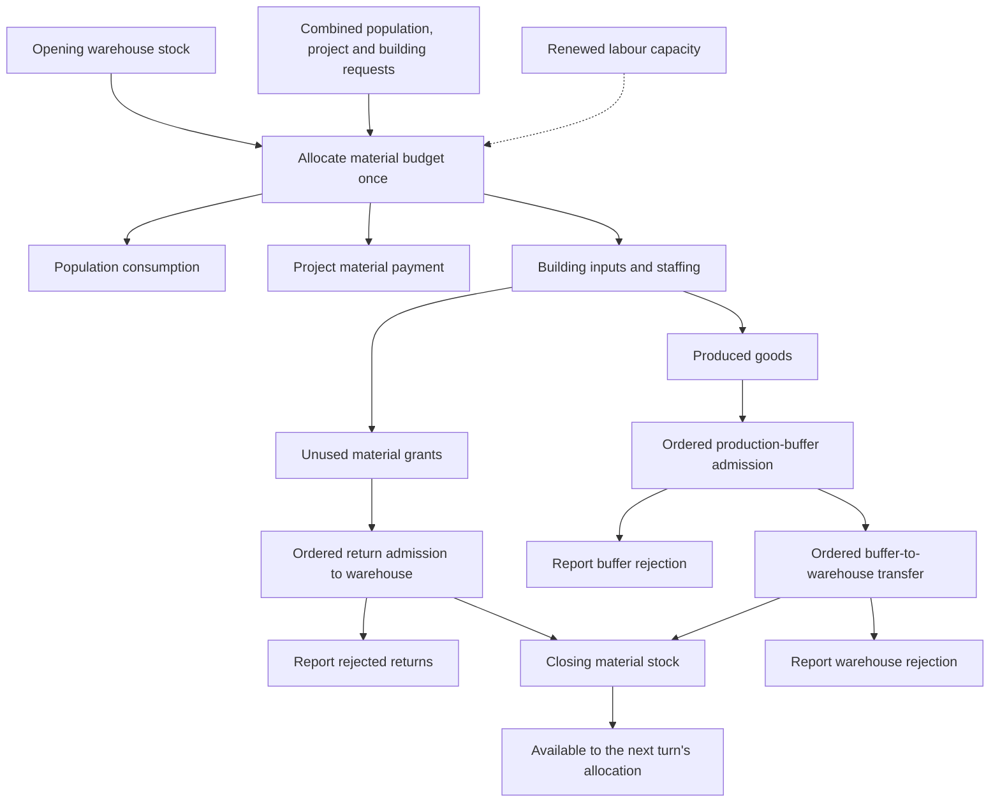

# Settlement Economy

The economy distributes limited integer quantities among population, buildings
and projects.

## Class view

`Labour` is renewable capacity derived from population, not a stored physical good consuming space.

## Resource activity

Each addition divides its input into accepted and rejected quantities. Rejections are losses.

## Allocation and production rules

Allocation is proportional by demand, with largest remainders distributing whole
units. Equal remainders use fixed recipient order: population, building IDs, then
project IDs.

Buildings run recipes in definition order against remaining material grants.
Inputs round up and outputs round down using exact execution fractions. Unused
grants return at turn end and are not reallocated within that turn.
