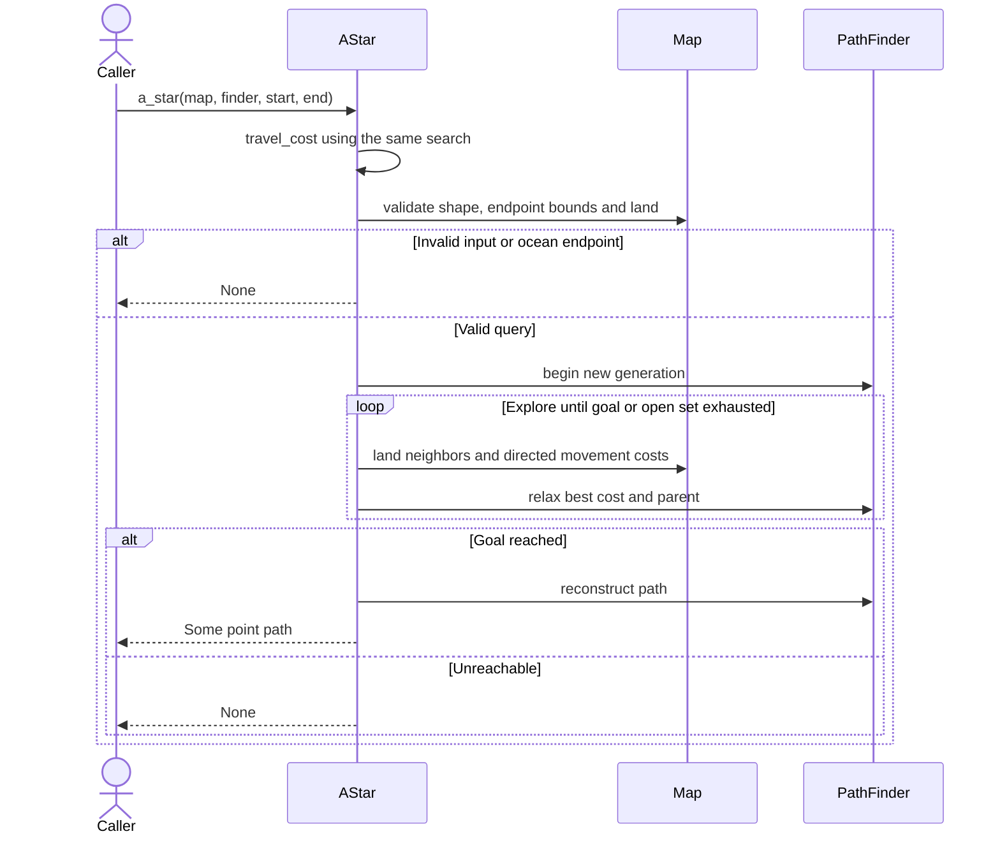

# Pathfinding

The map uses an eight-neighbor land grid. Map overlays, caravan route creation
and building productivity share its movement rules. Costs are directed: an uphill
journey can cost more than the reverse journey.

| Query | Result | Current caller |
| --- | --- | --- |
| `AStar::a_star` | Optional point path | Map overlay and caravan construction |
| `AStar::travel_cost` | Optional minimum route cost | Building productivity |
| `DijkstraFlood::dijkstra_flood` | Points reachable within a budget | Reachable-area overlay |

## Route query sequence

`travel_cost` callers skip reconstruction and its path allocation. A mutable
`PathFinder` is reusable scratch storage for one fixed map shape, not a route
service with concurrent searches.

Exact costs, octile heuristic, overflow behavior and verification are in
[pathfinding algorithms](../implementation/pathfinding_algorithms.md).
