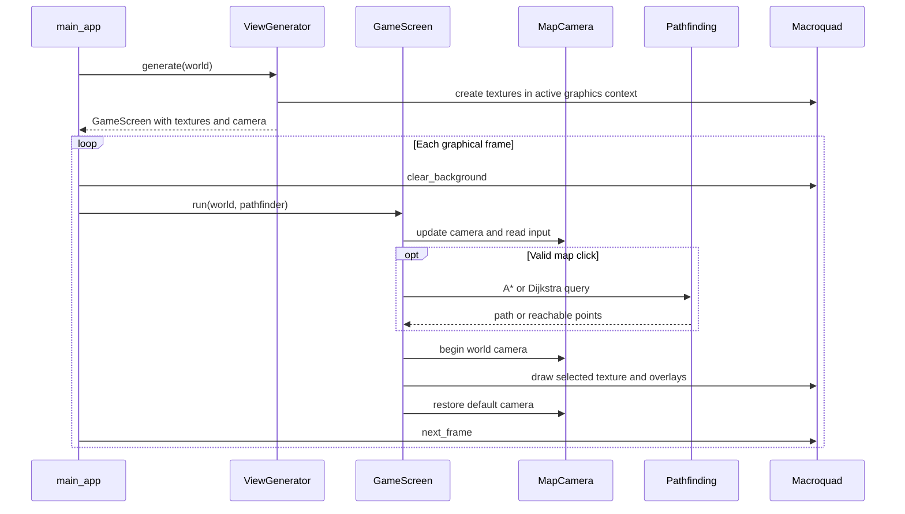
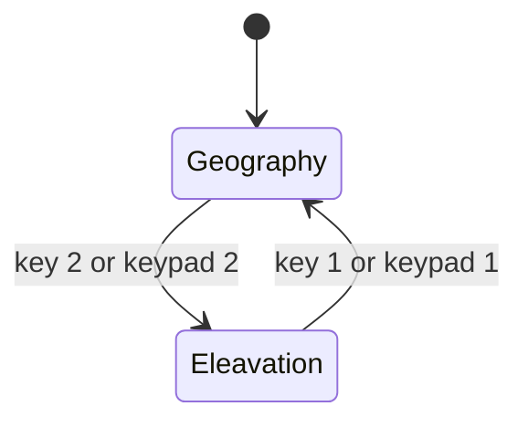

# Map Rendering and Camera

The Macroquad adapter is in `adapters/src/view/map/`. It reads `simulation_core` world state
and keeps rendering/input state separate from the domain. Source files and methods
are indexed in the [code map](../implementation/code_map.md).

## Composition

`ViewGenerator::generate()` builds `MapTextureData` and `MapCamera`, then creates
a `GameScreen`. Texture creation requires an active Macroquad graphics context.
There are no `MapView` or `MapRenderer` types in the current implementation.

`MapTextureData::generate_from_world()` builds two CPU images and GPU textures:
geography uses biome colors, elevation lighting, random color variation and
province/map borders; elevation uses a continuous height color mapping. Textures
use nearest filtering. Cosmetic random variation is not tied to the world seed.

`MapCamera` wraps a Macroquad `Camera2D`, initially framed to the map rectangle.
`begin()` selects it and `end()` restores the default camera.

## Frame loop and controls

`main_app` clears the background and calls `GameScreen::run()` each frame before
awaiting `next_frame()`. The screen updates camera/input, computes requested
pathfinding overlays and draws the selected texture and overlays.

| Input | Behavior |
| --- | --- |
| W/A/S/D | Pan, scaled by frame time and current zoom |
| Mouse wheel | Zoom in/out |
| 1 / keypad 1 | Geography texture |
| 2 / keypad 2 | Elevation texture |
| Left click | Select the last two map points and show their A* route in red |
| Right click | Show a Dijkstra reachable area with budget 1000 in purple |

Mouse positions are converted from screen to world coordinates and checked against
map texture bounds. An unreachable A* query clears its previous path. The shared
pathfinder is borrowed sequentially for queries. Rendering does not advance the
economy or caravan states.

## Startup and frame sequence

## Stored display mode

`Eleavation` is the current spelling of the Rust `CameraType` variant. These
states choose cached textures; switching mode does not regenerate terrain.
The frame loop has no call to `Simulation::step` or `World::inspect_tile`.
