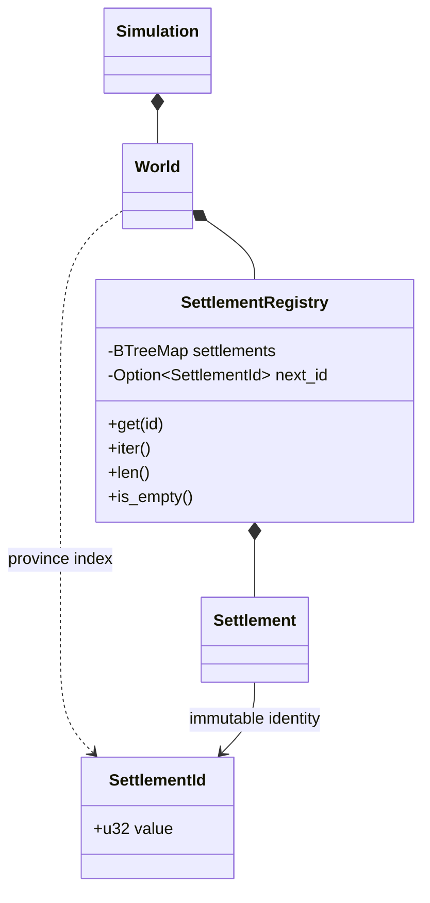
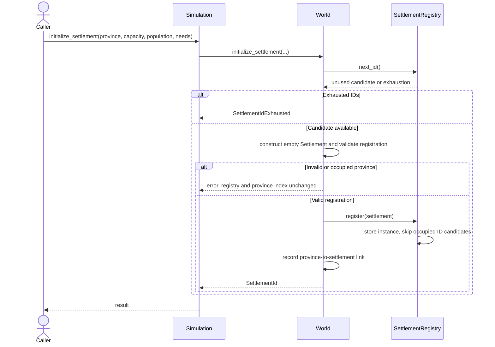

# Settlement Registry

`World` owns one `SettlementRegistry`; `Simulation` owns it through that world.
It stores actual settlement instances in `BTreeMap<SettlementId, Settlement>`.

## Class view

## Initialization sequence

`add_settlement(province_id, settlement)` is the alternative for explicitly chosen
IDs and pre-seeded inventories. It rejects duplicate IDs, unknown/occupied provinces
and settlements already containing buildings/projects.

## Stable access

- Registry, world and simulation iteration follow ascending `SettlementId`.
- Global phases and report keys use that same order.
- `Simulation::settlement(id)` returns `MissingSettlement` for an unknown ID.
- Registry/world lookups return an optional shared reference.
- Public registry access cannot mutate IDs, manager collections or province links.

State persists in memory across turns; no disk persistence or serialization is
implemented. For implementation methods see the
[source map](../implementation/code_map.md) and
[registry code](../../../core/src/domain/world/settlement_registry.rs).
