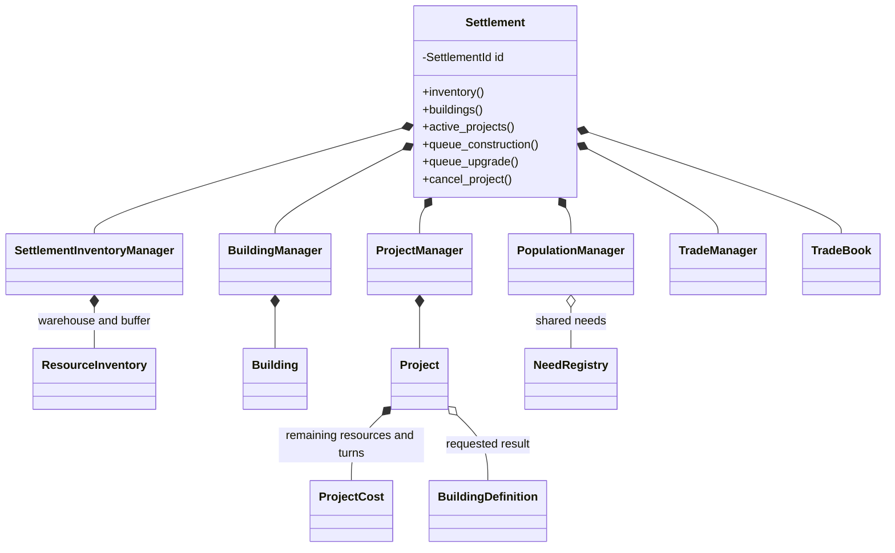
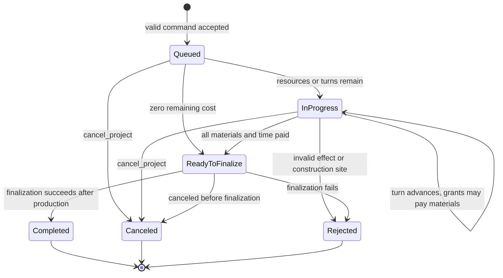
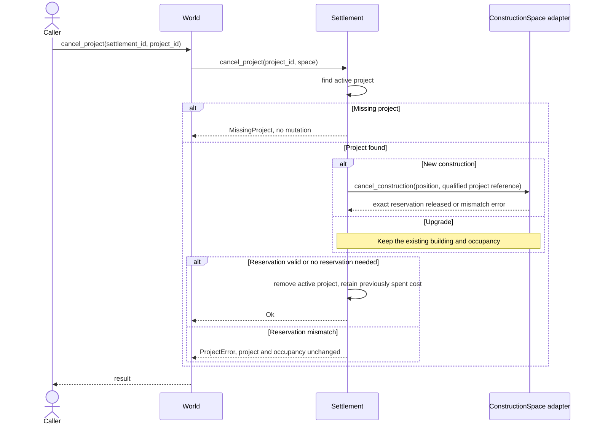

# Settlements

A `Settlement` coordinates its population, inventories, buildings and projects.
Its economic state persists between turns in the world's single registry. It is
not itself an implemented AI policy or a separate borrowed API object.

## Local class view

Gold, market templates, funded books and caravan order/return queues are also settlement-owned; see the full
[aggregate view](../overview/state_ownership.md). There is no public mutable
manager/collection getter. Read access and validated commands remain on `Settlement`.
Global callers use queued decisions or world entry points so spatial validation
uses the authoritative registry.

## Project lifecycle

These states are derived from `remaining_cost` and active-list membership, not a
stored project status enum. Construction and upgrades run concurrently across
active projects; there is no one-project-at-a-time construction queue.

A rejected queue command never enters this lifecycle. Time currently decreases
without material delivery, and completion waits for both time and material costs.
`RecruitUnit` is explicitly rejected; no unit is created. Command costs are caller supplied; blueprint `construction_cost` is not applied
automatically. Already paid materials are not refunded on rejection/cancellation.

Completion/rejection during a turn produces a `ProjectOutcome`; pending projects
produce none. Explicit cancellation returns immediately and has no later turn
event. Completed project history is not retained; inactive project numbers may be reused.

## Cancellation sequence

Registration and identities are described in [registry](settlement_registry.md).
Spatial reservations are described in [territory](territory.md). The
[global turn](../overview/turn_lifecycle.md) schedules shared settlement phases.
Exact local API, time/cost examples and report contracts are in
[settlement commands](../implementation/settlement_commands.md).
