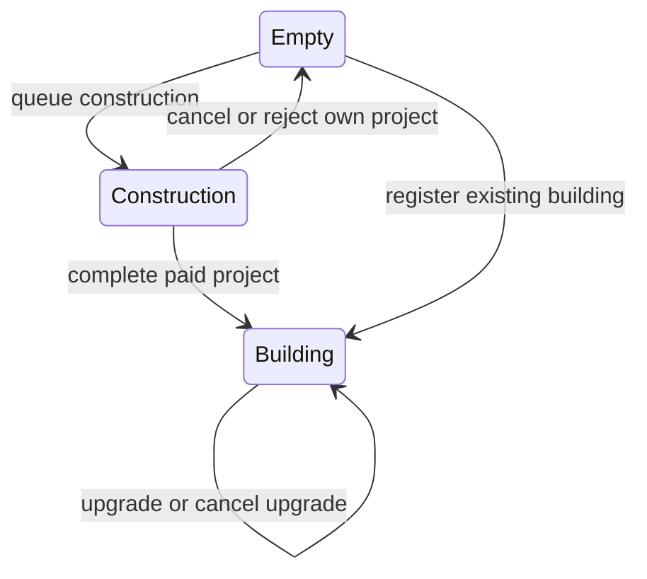
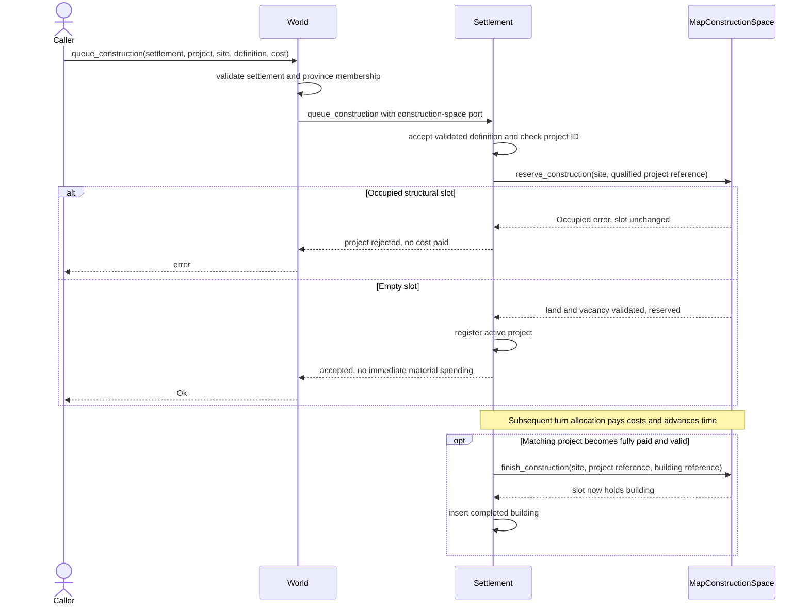
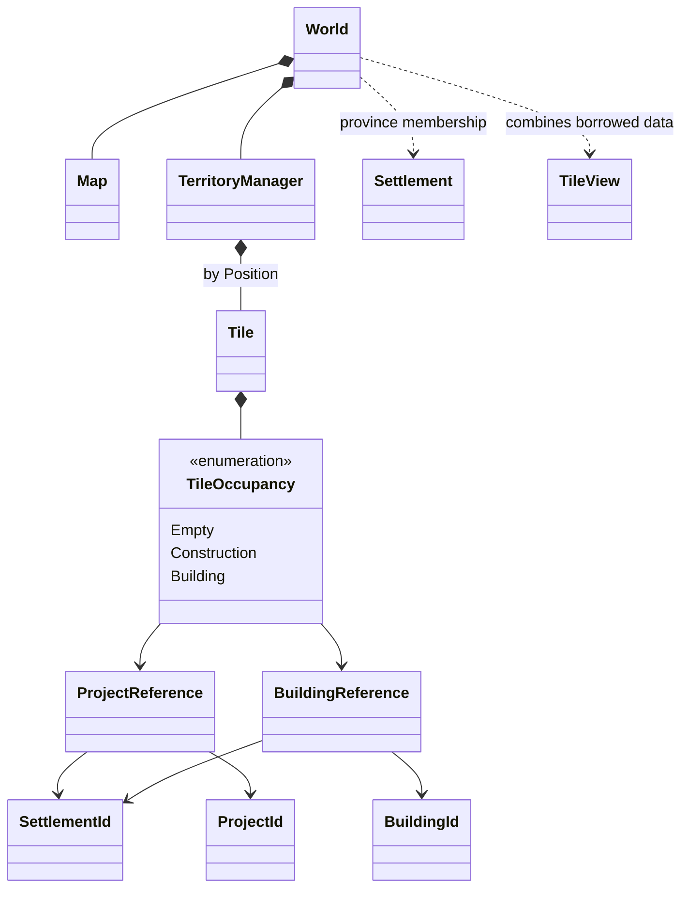

# Territory and Tile Inspection

`World` owns one global `TerritoryManager`. World entry points resolve the settlement and validate province membership, then delegate lifecycle changes to that settlement.

## Spatial data

| Source | Data |
| --- | --- |
| `Map` | Terrain and the province ID of each grid position |
| `World::province_settlements` | Optional settlement registered in a province |
| `World::settlements` | One `SettlementRegistry` storing instances in ascending `SettlementId` order |
| `TerritoryManager::tiles` | Sparse `HashMap<Position, Tile>` of structural occupancy |
| `Settlement` | Actual building instances and active projects |

A registered settlement belongs to exactly one province. A province contains at
most one settlement and may remain empty.

`TileOccupancy` is `Empty`, `Construction(ProjectReference)` or
`Building(BuildingReference)`. References include both settlement ID and local
project/building ID.
## Construction and cancellation

- `World::queue_construction` checks province membership; the settlement validates
  the project ID and accepts a validated definition, then its `ConstructionSpace` adapter validates coordinates, land and the vacant slot before reservation.
- `World::add_building` applies the same placement checks and registers a completed
  building. It cannot replace a project or another building.
- The global turn coordinator uses the same shared registry for settlement phases.
  Construction is revalidated before allocation and completion. Completion replaces
  the reservation with the actual building reference.
- `World::queue_upgrade` delegates an upgrade of an existing local building. Its
  structural slot remains a building during the project.
- `World::cancel_project` delegates cancellation to `Settlement::cancel_project`.
  A construction reservation must match the exact project and settlement. A mismatch
  preserves both project and tile. Canceling an upgrade leaves its building intact.

Current building types require land, using `Elevation::OCEAN_LEVEL`.
Cancellation stops further costs; materials already consumed remain spent.
If province membership changes between turns, the world rejects that settlement's
turn before spending, preserving projects and reservations.

## Inspection

`World::inspect_tile(position)` returns a borrowed `TileView` containing:

- Position and terrain reference.
- Province ID and optional `province_settlement` membership reference.
- Optional `occupant_settlement`, resolved from the qualified structural owner.
- Occupancy snapshot and the referenced building or new-construction project.

Implementation: [registry](../../../core/src/domain/world/territory.rs),
[world commands](../../../core/src/domain/world/state/construction.rs),
[inspection](../../../core/src/domain/world/state/inspection.rs),
[settlement commands](../../../core/src/domain/settlement/model/commands/projects.rs).

## Construction sequence

## Spatial class view

Tile lookup combines province membership and terrain from the map with occupancy;
it does not infer deposits from warehouse goods or reveal an AI agent's knowledge.
The current graphical click handler runs pathfinding, not `inspect_tile`.

## Inspection and economic integration

`TileView::province_settlement` describes current province membership;
`occupant_settlement` resolves the settlement-qualified structural reference.
They may differ after province edits. A dangling reference or an object whose
position disagrees with the tile returns `WorldError::InconsistentOccupancy`.
Turn preflight rejects projects outside their registered province before trade
funding, movement or construction spending. Trading and construction use the
same persistent registered settlement instances.
