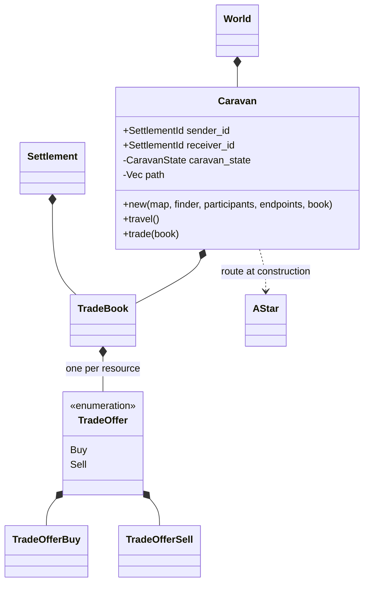
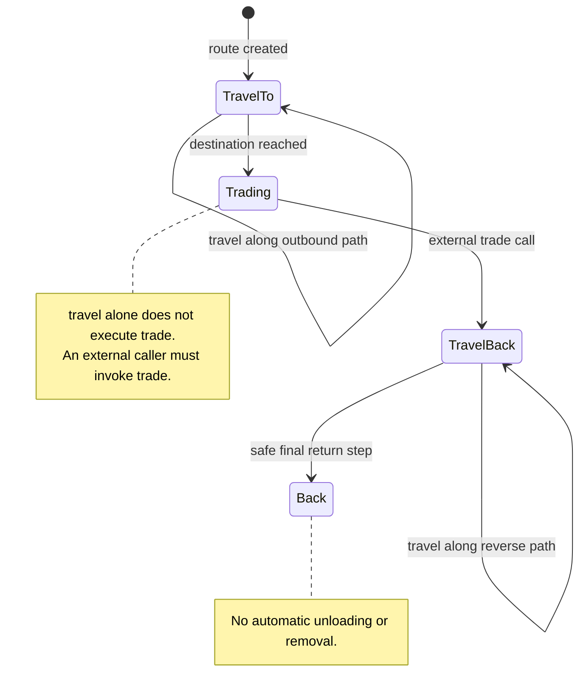
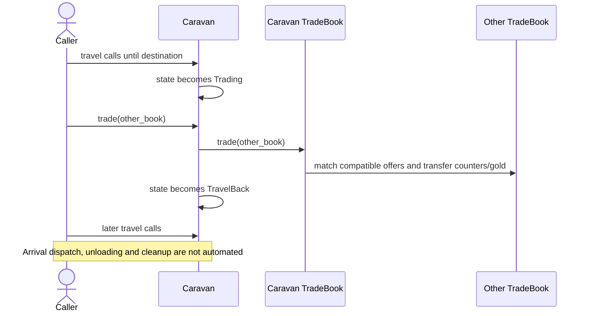

# Trading and Caravans

Status: domain prototype, introduced on develop before the code reorganization.
The graphical executable does not create settlements/offers/caravans or drive their turns.
The headless coordinator runs local trade funding/returns, but does not match books or move caravans.
Source responsibilities and method names are listed in the [code map](../implementation/code_map.md).

## Data and execution

`GoldInventory` stores `u32` currency separately from warehouse materials.
`TradeBook` owns reserved gold and one `TradeOffer` per resource. Sell offers
describe available stock and a minimum price; buy offers describe remaining demand,
purchased stock and a maximum price. `calculate_demand()` requests materials for
sales and quantity multiplied by the maximum price for purchases.

`Settlement::process_turn()` asks `TradeAllocationEngine` to reserve these goods
and funds before local population/building/project allocation. At the end of the
turn it drains purchased goods, unsold stock and remaining gold back into the
settlement inventories. A newly constructed settlement has an empty trade book;
there are currently no public settlement commands to configure it.

`TradeBook::trade()` matches buy/sell offers in two books when the seller's minimum
price does not exceed the buyer's maximum. Unit prices use their integer midpoint.
When funds are insufficient, the transaction scales quantities proportionally,
then spends remaining funds on affordable quantities. This is a bilateral matching
implementation, not a global market/order-book service.

`Caravan` lives in `simulation_core::trade::caravan`. It carries a trade book and
follows a stored A* route between explicitly supplied start/end `Point` values.
Its constructor accepts `&Map` and a reusable `PathFinder`, not a whole `World`.
It returns `Option<Caravan>`; missing or invalid routes return `None`.
Its state progresses through `TravelTo`,
`Trading`, `TravelBack` and `Back`. `trade()` must be called externally on arrival.
`World` owns the caravan collection; `caravan_travel()` advances movement only.
Sender and receiver IDs are carried as participant identity only. The caller
resolves positions (for example from province centroids); the constructor does not
use IDs to index provinces or require a settlement registry.

## Current limitations

The reorganization renames `TradeLog` to `TradeBook` and decouples caravan
construction from the whole world. Matching arithmetic and movement rules are
unchanged. In particular:

- Offer fields are private and have no public constructors. `TradeBook::new()`
  accepts a map of offers, but external callers cannot construct populated offer
  values through a supported constructor. There are no settlement market commands.
- Gold and several price/quantity operations use unchecked `u32` arithmetic.
- Reserved trade goods, purchases and trade overflow are not represented in
  `InventoryTurnReport`. Its opening snapshot precedes reservations, and its
  closing snapshot precedes trade returns. `is_balanced()` therefore does not
  establish conservation for turns with nonempty trade activity.
- Returned goods use direct inventory insertion; rejected quantities are ignored
  and do not follow the settlement manager's ordered batch admission/reporting.
- `travel_back()` subtracts the movement step before checking the lower bound,
  which can underflow near the route origin.
- Routes are fixed after creation. No rerouting, cargo capacity, arrival dispatch,
  finished-caravan removal or global turn scheduling is implemented.

Future logistics and information exchange require separate implementation;
the prototype below is not an automatic trading system.

## Prototype class view

Participant IDs are typed `SettlementId`, but caravan construction does not
validate them against the registry. It builds a route from explicit endpoints.
The constructor takes its book by value and does not return it on route failure;
there is no supported dispatch transaction protecting already committed cargo.

## Stored caravan states

These are the actual `CaravanState` variants. Movement is in path indices, not
an A* cost budget. The diagram shows normal transitions, not a guaranteed round
trip: the existing return subtraction can underflow before reaching `Back`.

## External trade sequence

`Simulation::step` does not execute this sequence. Information observations,
multiple trade stops, transport capacity and market discovery remain unimplemented.
