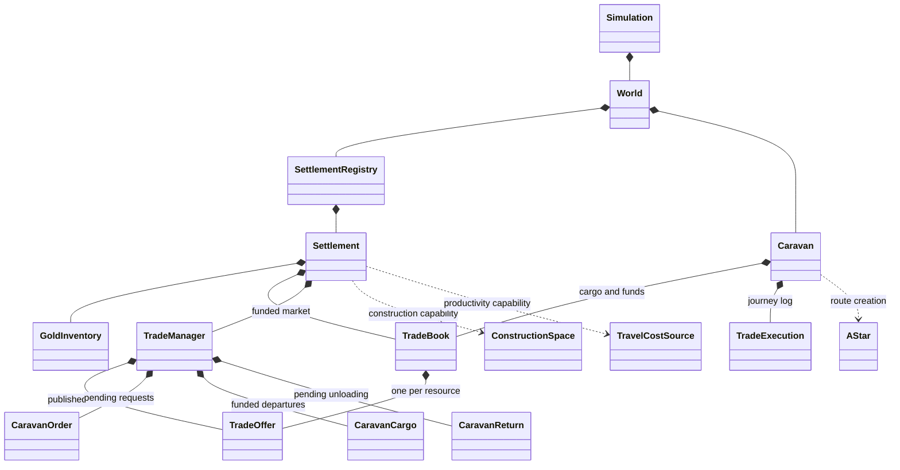
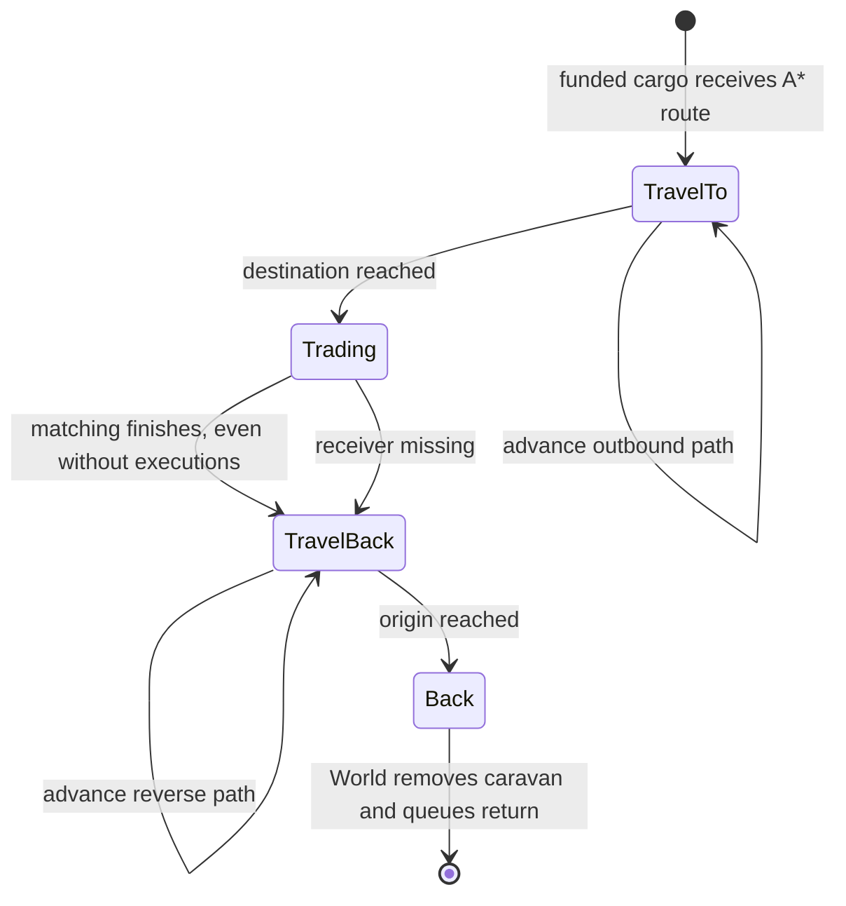

# Trading and Caravans

Trading runs inside `Simulation::step()`, including headless execution. World owns
registered settlements and active caravans; each settlement owns its treasury,
published market templates, funded market book and order/departure/return queues.
The graphical executable does not yet create or drive a trading scenario.

See the [implementation reference](../implementation/trading.md) for file and method
responsibilities, and [global lifecycle](../overview/turn_lifecycle.md) for phase order.

## Ownership and boundaries



Settlement funds cargo and trades with supplied visitors. It does not choose map
coordinates, calculate caravan routes or move the world's caravans. World resolves
participants by `SettlementId` and supplies visitors and temporary map adapters.
No Map/PathFinder reference is stored in Settlement.

## Offers and funding

`TradeOffer::sell(units, minimum_price)` reserves warehouse materials;
`TradeOffer::buy(units, maximum_price)` reserves treasury gold. A book contains at
most one offer per resource. Settlement commands reject labour as a tradable good.

Published market offers persist until replaced or cleared. Preparation rebuilds
and funds a fresh book from those templates each turn; previous purchases do not
reduce the next turn's published quantity. Caravan orders are one-shot requests:
preparation drains them after funding the market, in submission order. Funding
may be partial; orders with neither materials nor gold are consumed and reported
as unfunded. Trade reserves stock before local population/building/project allocation.

## Global execution

```mermaid
sequenceDiagram
    participant Sim as Simulation
    participant W as World
    participant C as Existing caravans
    participant S as Registered settlements
    participant M as Market book
    Sim->>W: preflight all settlements; execute decisions
    Sim->>W: begin_trade_turn()
    W->>C: move once; collect completed returns
    W->>S: queue returns at sender
    loop Every settlement in ascending ID order
        Sim->>W: prepare_settlement_turn(id, finder)
        W->>S: prepare_turn(environment, arrived visitors)
        S->>M: reserve published offers
        S->>S: fund queued caravan orders
        S->>M: trade_with_visitors(visitor books)
        S->>C: record mirrored executions; start return state
    end
    Sim->>S: global allocation, consumption, construction, production
    Sim->>S: finish_turn(state, environment)
    S->>S: unload returns, admit materials and record losses
    Sim->>W: finish_trade_turn(locations, finder)
    W->>C: create A* routes for funded departures
    Note over W,C: Route failures queue unchanged cargo for next-turn unloading
    Sim->>Sim: increment turn
```

New caravans first move next turn. Arrivals can trade in their arrival turn, but
start moving home in a later turn. Market purchases, unsold stock and caravan
returns join production at economic updates, after earlier allocation/trade.
Gold returns directly to the treasury; material admission uses storage order,
warehouse/buffer capacities and loss reporting. New receipts cannot satisfy
requests earlier in the same turn.

Transport boundaries are not separate `TurnPhase` variants. The execution trace
contains seven settlement phases, not a complete transport event trace.

## Matching and deterministic order

Opposing offers match when seller minimum <= buyer maximum. The integer midpoint
is the unit price; zero-price matches are skipped. Bilateral matching scales
purchases to funds, then spends affordable remainders in price/resource order.

With several visitors, the market splits contested offers and its gold into
near-equal shares, redistributes unused shares over at most 64 sharing rounds,
then attempts bilateral trades in visitor order. This is deterministic sharing,
not an auction or a guarantee of equal final value. World sorts visitors by
sender ID; equal sender IDs retain existing order. Settlements follow registry
order and caravan orders follow queue order. A caravan trades with one receiver.

## Caravan states and routes



`Caravan::from_cargo` returns the original cargo on route failure; the coordinator
uses it to preserve committed goods/funds. Lower-level `Caravan::new` returns
`Option` and does not recover its input book on failure.

Simulation uses the first land tile of each registered province in row-major
order as its endpoint. This temporary convention is not a capital or market
position. Missing endpoints produce `NoRoute`. `TradeNetwork` instead accepts
explicit endpoint maps. Participant IDs never serve as coordinates.

Movement advances up to 10 stored path indices per turn. A* terrain costs influence
route selection, not a movement budget. Paths are stored once, reversed for return
and not recalculated after map edits.

## Reports and conservation

`TurnReport.trade` records market reservations/executions, funded departures,
unfunded orders, unloaded returns, received materials and gold. Market executions
use the receiving settlement's perspective; caravan logs mirror them to the
sender. A departure report means funding occurred, not that routing succeeded.
Routing failures become returned-cargo reports when unloaded in a later turn.

For each material, `InventoryTurnReport::is_balanced()` checks:

```text
opening stock + produced + trade received
    = closing stock + population consumed + project consumed
      + production inputs consumed + trade reserved + losses
```

Stock snapshots include warehouse and buffer, not cargo in transit. Internal
unused grants are not new production. Gold is separate and not validated by this
equation. This is local material accounting, not a world-wide cargo/currency ledger.

## Entry points and current limits

Use `Simulation::step()` for global turns. `TradeNetwork::process_turn()` is an
alternative runner using local turns and explicit endpoints; do not call both
for the same intended turn. `World::process_settlement_turn()` handles arrived
visitors but does not move or dispatch global caravans. Standalone
`Settlement::process_turn(environment, visitors)` accepts an empty visitor slice.

Trade commands currently exist on Settlement, not in queued `SettlementDecision`
variants. Scenarios can configure offers/orders before registration; Simulation
has no public mutable world/settlement getter for dynamic agent commands.

Other limits: fixed routes/speed, no capacity, multi-stop trade, discovery, world
observations, diplomacy or settlement removal API. Some price/quantity and gold
operations still use unchecked `u32` arithmetic. World caravans remain a public
collection. Externally injected returns with unknown senders are removed without
unloading their cargo.

Verification includes inline offer/book/market/caravan and settlement lifecycle
tests, plus [territory/trade integration tests](../../../core/tests/territory_trade_integration_tests.rs)
covering shared state, construction, cancellation, overflow, preflight rejection
and global/local runner equivalence.
