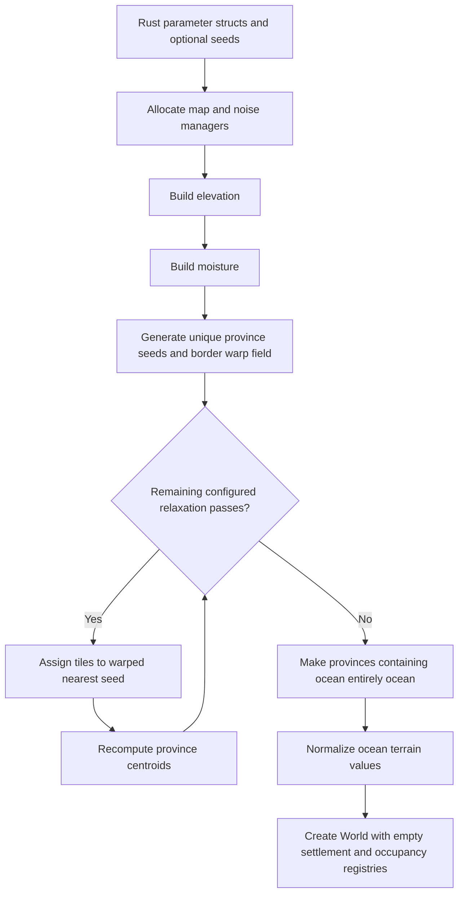

# World Generation

`WorldBuilder` in `core/src/domain/world/generation/` generates a flat grid map
with terrain and provinces. It belongs to the `simulation_core::world::generation`
module.

## Configuration

Generation parameters are Rust structs in `world/generation/config.rs`, separate
from the runtime economy parser in `core/src/configuration.rs`.

| Parameter type | Current defaults |
| --- | --- |
| `WorldDimensions` | Width 2000, height 1500 |
| `VoronoiConfig` | 500 provinces, 3 relaxation passes |
| `NoiseConfig` | Elevation scale 200, moisture scale 600, range 0..1 |
| `WarpConfig` | Scale 50, intensity 12.5 |
| `SeedConfig` | Point seed 67, borders 69, elevation 420, moisture 2137 |
| `ElevationTuningFineConfig` | Radial multiplier 0.8, exponent 4, dropoff multiplier 1.5, addition 0.25 |

`generate_default()` uses these defaults; `generate()` accepts explicit parameters.
Missing optional seeds use random values. `NoiseManager` uses four-octave Perlin
FBM and supplies noise samples, coordinate warp and island elevation falloff.

## Pipeline

1. Allocate terrain and territory buffers in `WorldBuilder::new()`.
2. Fill elevation with warped island noise and moisture with warped noise.
3. Generate unique province seeds, empty province records and a border warp field.
4. Repeatedly assign tiles to the nearest warped seed and recompute centroids.
5. Apply `edge_alignment()`: if a province includes an ocean tile, make that whole
   province ocean.
6. Apply `ocean_set()`: normalize ocean elevation to zero and moisture to one.
7. Construct `World` with the active resource catalog and generate ore deposits.

## Ore deposits

`World::generate_deposits(&DepositGenerationConfig)` extends the existing tile
deposit registry. Explicit configuration is validated before placement, including
resource membership, probabilities in 0..=100 and positive vein size. The default
builder selects the supported ores present in its catalog and derives the deposit
seed from the province point seed. Existing deposits retain their tiles.

Each province rolls independently for each ore. Its representative biome is the
most frequent biome among its land tiles. Water tiles are excluded. Ties follow
the columns of this table, from left to right. An all-water province has no focus.

| Ore | Desert | Grassland | Forest | Rainforest | Hills | Taiga | Tundra | Snow |
| --- | --- | --- | --- | --- | --- | --- | --- | --- |
| Coal | 0 | 0 | 25 | 10 | 5 | 30 | 0 | 0 |
| Iron ore | 0 | 0 | 5 | 0 | 25 | 5 | 30 | 20 |
| Copper ore | 30 | 0 | 0 | 0 | 20 | 0 | 5 | 0 |
| Tin ore | 5 | 0 | 0 | 0 | 0 | 0 | 10 | 20 |

A successful roll chooses an unoccupied land focus in the source province.
Focuses are placed before growth. Each vein expands through randomly selected
cardinally adjacent land tiles, up to 16 tiles including its focus by default.
The growth limit is configurable. Province and biome boundaries permit growth,
while ocean and occupied deposit tiles block it. Collisions retain the existing
resource, and lack of available space can produce shorter veins. The report
records focuses, their source provinces, vein tiles and unplaced focuses.

Random streams for rolls, focus selection and growth are derived from the seed,
province and canonical resource ID. The same map, catalog and configuration
reproduce the same registry. Growth length does not change the initial rolls.

Ownership continues to follow the province of each individual deposit tile.
A vein crossing a border therefore supplies different owners on its two sides.

## Coastal land

`Map::is_coastal(position)` identifies land sharing a side with an ocean tile.
Diagonal contact and the edge of the map do not establish a coast. This property
is derived from the current terrain and also appears in tile inspection and
settlement observations. It leaves the existing biome classification intact.

`BuildingDefinition::requiring_coast()` marks a land building for a coastal site.
Construction, upgrades and scenario registration validate this requirement along
with ownership, occupancy and optional deposits. `CoastRequired` explains a failed
coastal placement. Marine buildings use a coastal land site.

Terrain filling and tile assignment use Rayon. `Voronoi` holds
seed generation, Voronoi assignment and centroid helpers.

## Terrain data

| Classification | Thresholds |
| --- | --- |
| Elevation | Ocean below 0.2; lowland below 0.4; plains below 0.6; highland below 0.8; mountain otherwise |
| Moisture | Dry below 0.4; normal below 0.5; humid below 0.6; wet otherwise |

`Biome::determine()` combines both categories into ocean, desert, grassland,
forest, rainforest, hills, taiga, tundra or snow. Pathfinding reads raw elevation,
not the biome category, when computing movement costs.

## Assumptions

Generation assumes valid, nonzero dimensions and a feasible province count.
Unique-point generation cannot terminate when more points are requested than
available tiles. `Province::centroid` returns `(0, 0)` for an empty province;
this fallback does not enforce nonempty Voronoi regions. `Map::new()`
does not validate its input vector lengths. Callers must currently enforce these
constraints. Rendering adds unseeded cosmetic noise, so identical domain seeds do
not guarantee identical texture pixels.

## Generation activity

Generation does not found settlements, create resource deposits or configure
building catalogues.
