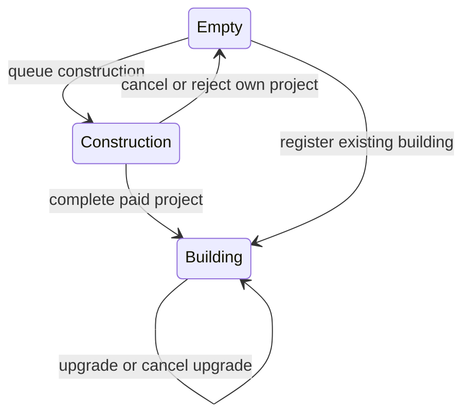

# Territory and Tile Inspection

`World` owns one global `TerritoryManager`. Settlements own buildings, projects
and economic decisions. World entry points resolve the settlement and validate
province membership, then delegate lifecycle changes to that settlement.

## Spatial data

| Source | Data |
| --- | --- |
| `Map` | Terrain and the province ID of each grid position |
| `World::province_settlements` | Optional settlement registered in a province |
| `World::settlements` | One `SettlementRegistry` storing instances in ascending `SettlementId` order |
| `TerritoryManager::tiles` | Sparse `HashMap<Position, Tile>` of structural occupancy |
| `Settlement` | Actual building instances and active projects |

A registered settlement belongs to exactly one province. A province contains at
most one settlement and may remain empty. `World::add_settlement(province_id,
settlement)` validates both registrations before inserting either. There is no
separate province assignment or transfer command. Settlements must have no
buildings/projects when registered; importing existing structures is not supported.

`Position` implements `Hash` and retains signed coordinates. Map lookups reject
negative, out-of-bounds or unbacked coordinates. Province IDs are resolved as IDs,
not assumed to equal their offsets in `World::provinces`.

`TileOccupancy` is `Empty`, `Construction(ProjectReference)` or
`Building(BuildingReference)`. References include both settlement ID and local
project/building ID. The settlement component is a typed `SettlementId`, independent
of province indices. Two settlements can therefore use the same local building or project numbers.
An absent registry entry represents an empty structural slot; it does not imply
that the position exists on the map. Use the checked world reads for map inspection.

## Construction and cancellation

- `World::queue_construction` checks province membership; the settlement validates
  the definition, project ID, coordinates, land and vacant slot, then reserves it.
- `World::add_building` applies the same placement checks and registers a completed
  building. It cannot replace a project or another building.
- `World::process_settlement_turn` passes the same shared registry to the settlement.
  Construction is revalidated before allocation and completion. Completion replaces
  the reservation with the actual building reference.
- `World::queue_upgrade` delegates an upgrade of an existing local building. Its
  structural slot remains a building during the project.
- `World::cancel_project` delegates cancellation to `Settlement::cancel_project`.
  A construction reservation must match the exact project and settlement. A mismatch
  preserves both project and tile. Canceling an upgrade leaves its building intact.

Current building types require land, using `Elevation::OCEAN_LEVEL`. There are no
marine or building-specific placement exceptions yet. Resource deposits are not
modeled and do not participate in placement validation.

Cancellation stops further costs; materials already consumed remain spent.
Unpaid costs are discarded. Cancellation is immediate and does not create a later
turn outcome. Missing/completed projects return `ProjectError::MissingProject`.
Cancellation can release an owned reservation even if map membership changed.

If province membership changes between turns, the world rejects that settlement's
turn before spending, preserving projects and reservations. A construction site
that becomes ocean is rejected by the settlement and releases only its own
reservation; earlier payments are not refunded.

Standalone settlement calls must receive and retain the same map/registry across
construction and turns. For settlements registered in a world, use the world entry
points so province checks and the authoritative registry cannot be bypassed.

## Inspection

`World::inspect_tile(position)` returns a borrowed `TileView` containing:

- Position and terrain reference.
- Province ID and optional registered settlement reference.
- Occupancy snapshot and the referenced building or new-construction project.

The referenced objects are not cloned. For a building tile, `project` is absent;
active upgrades remain available through the settlement's active projects.
Ocean and empty provinces are valid inspection targets. Invalid coordinates,
missing map layers and unknown province IDs return explicit errors.

This is authoritative world inspection for tools or a future map panel. It is not
an agent observation and does not apply visibility or historical knowledge.
Natural deposits, mobile units, and the actual click panel remain separate features. Global turns are coordinated
by [Simulation](simulation.md). Adding them must preserve their independent layers:
clearing a construction slot must not remove deposits or units.

Implementation: [registry](../../core/src/world/territory.rs),
[world commands](../../core/src/world/state/construction.rs),
[inspection](../../core/src/world/state/inspection.rs),
[settlement commands](../../core/src/settlement/commands/projects.rs).
